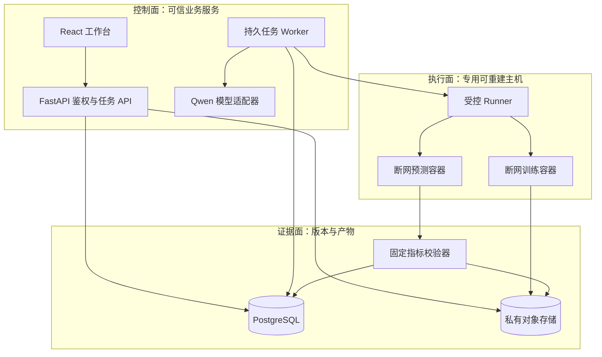
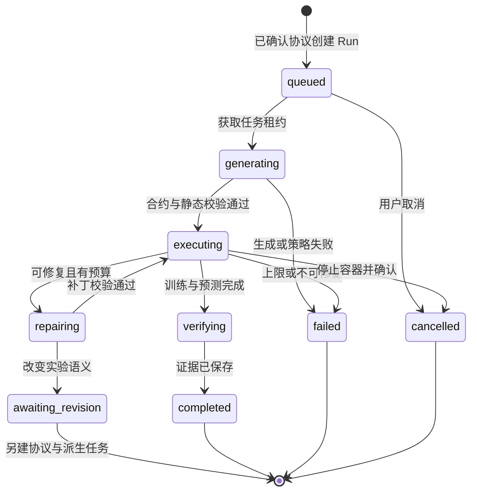

# Paper2Run 可落地技术架构

_技术设计基线：2026-09-19。基于队友 PRD 与静态原型，面向黑客松可交付版本和赛后持续使用；本文是设计，不代表工程已经实现或性能已经达标。_

---

> **总设计优先级：** 首版工程边界以 [Paper2Run 统一工程设计](11-Paper2Run统一工程设计.md) 为准。本文保留产品范围、技术取舍、科研可比性和安全原则等专题背景；与总文档冲突时，不再沿用本文的旧模型网关或 Qwen 专用适配器表述。

## 🎯 产品结论与交付边界

### 推荐定位

Paper2Run 应定位为**面向受支持机器学习实验的、证据驱动的论文复现工作台**，而不是“任意论文上传后自动证明真伪”。核心价值不是替用户写几段 Python，而是把论文依据、实验协议、代码变更、执行日志与独立评测连接起来，让用户知道“运行了什么、哪里不一致、这个结论能信到什么程度”。

保留原设计的四个页面、六阶段流水线、解析确认点、自动修复时间线和资产下载。架构重点补上五项原稿欠缺：**实验协议契约、持久状态与恢复、执行隔离、独立评测、证据可追溯**。

需求依据：[队友 PRD](../Paper2Run-PRD.pdf) 正文 §4–10；界面依据：[静态原型](../Paper2Run-原型.html)。赛事依据与证据限制详见 [比赛规则与交付清单](01-比赛规则与交付清单.md)。当前目录没有后端、前端工程、测试或部署配置，原型的数值与曲线均为演示数据。

### 首版真正支持什么

建议首版以**邀请制、单团队、多项目、单 GPU 执行槽**交付。支持用户上传论文、修改并确认实验协议，生成新代码和新任务，实际运行并保存历史；不能只提供三个写死的演示按钮。

- 论文范围：机器学习中的图像分类，优先原文明确包含 CIFAR-10 实验的论文。
- 执行范围：维护者审核过的数据集与运行环境；一个任务选一个具体实验和一个主要指标。
- 用户范围：研究生、算法工程师；评委拥有只读演示入口，不需要自己的模型 Key。
- 模型范围：运行中的语义解析、规划、生成与修复使用 Qwen；解析器、调度器、评分器用确定性程序。
- 未支持论文：仍可解析与导出实验说明，但显示“不支持自动执行”及缺失条件，不能悄悄替换为示例实验。

### 三种实验模式必须分开

| 模式 | 用途 | 可给出的结论 |
|---|---|---|
| `smoke` 冒烟运行 | 少量样本与步骤，检查能否执行 | 流程跑通或失败 |
| `scaled` 缩减实验 | 减少数据、步骤或改变模型 | 简化设置下的结果 |
| `reference` 原文协议尝试 | 尽量遵循选定原文实验 | 选定指标的复现情况 |

模式和协议差异始终显示在页面、报告及下载包中。`reference` 也不天然成功：实验未完成、证据缺失或关键条件改变，都不能判为“复现达标”。从 ImageNet 改成 CIFAR-10 是**新实验**，不是原实验中的无害参数修改。

首版不做：任意 GitHub 仓库执行、任意依赖安装、大模型预训练、Transformer/DQN/U-Net 完整复现、公开匿名代码执行、计费系统、社区排名、多租户集群、自动联网寻找数据、未经核实的论文可信度评级。预训练权重评测若以后开放，必须单列为 `evaluation_only`，不能算从头训练复现。

## 🔍 原稿需修正的技术与科研问题

### 演示数据不是基准真值

原型同时展示了 ResNet-18 代码、ResNet-20 曲线、11.2M 参数量及 94.10% 参考准确率；又将 CIFAR-10 图标为 Fig.4。应删除这些占位数的业务逻辑，只保留视觉设计。原型定位：模型代码约第 866 行，原文目标约第 808–818 行，报告约第 988–1032 行。

本次核对的 ResNet 原论文 §4.2 / Table 6 / Figure 6 给出：CIFAR 架构为 `6n+2` 层，ResNet-20 约 0.27M 参数，Table 6 的 test error 为 8.75%；CIFAR 训练曲线是 Figure 6，Figure 4 对应 ImageNet；CIFAR 设置包括初始学习率 0.1、weight decay 0.0001、batch size 128、在 32k/48k iterations 降学习率并在 64k 结束。[^1]

这些数值只说明**原型不能作为事实源**，不是本产品已取得的结果。落地时要锁定上传文件 SHA-256 和论文明确版本，再由人工复核所选表格行。`100 - error_percent` 可转为 accuracy，但必须记录转换表达式、原始单位和来源，不能混用不同模型行或 best/mean 统计。

### 评分不是论文真实性判断

原 PRD 的 60/25/15 权重是产品自己的解释性指标，不是比赛评分，也没有经过科学校准。“核心结论成立”过强，首版改为“选定指标在约定容差内”“未达到约定容差”“条件不同，不可直接比较”“仅验证流程”。

不得把 batch size、epoch 等配置一致性当成模型性能指标的加分项；不得因为一个子实验跑通而替整篇论文背书；不得把 5% 数据子集结果与原文完整训练结果算成一个可比总分。

### 安全与环境约束

`docker --network=none --memory=8g` 远不是完整安全方案。Docker 与宿主共享内核，daemon 控制权及可写挂载都需要严格限制；容器不是完全防逃逸的安全证明。[^2] **`--memory=8g` 限制主机内存，不是 GPU 显存配额**。GPU OOM 必须由真实显存监控与设备调度处理。

断网训练仍需要数据与依赖，因此必须把“受控联网准备”与“无网络执行”拆开。不能为了修复 `ModuleNotFoundError` 就允许生成代码临时 `pip install`。

原稿使用 PyMuPDF，其官方说明为 AGPL/商业双许可。[^3] 本方案默认采用 `pypdfium2` 的文本/页面渲染接口，并保留替换适配器；其本体为宽松许可，但分发 PDFium 及依赖仍需携带对应许可。[^4] 这是减少未定商业化模式下的授权耦合，不是对具体发布方式作法律保证。

## 📦 系统架构与技术选型

### 控制面、执行面、证据面

采用**模块化单体 API + 独立任务 Worker + 独立 Runner 主机**。业务服务不拆微服务，执行安全边界必须拆。首版不用 Redis、Celery、LangGraph、向量数据库或 MLflow 作为必选基础设施；简单持久任务队列放 PostgreSQL，避免为一条有限状态链增加多套真相来源。



图中的产物箭头是逻辑流向：实际由 Runner 在停止容器后验证和上传产物，生成代码本身没有对象存储或数据库凭据。指标校验器是可信程序模块，不意味着首版再部署一个微服务。

### 固定选型

| 层 | 建议技术 | 选择原因 |
|---|---|---|
| Web | React + TypeScript + Vite | 与原型一致，避免额外全栈框架 |
| 页面与数据 | React Router + TanStack Query | 路由、请求状态与缓存职责清晰 |
| 文档与代码显示 | PDF.js、CodeMirror、轻量图表组件 | 原文定位、补丁对比、真实曲线 |
| API | Python 3.11/3.12 + FastAPI + Pydantic 2 | 类型化实验契约与 OpenAPI |
| 数据 | PostgreSQL + SQLAlchemy 2 + Alembic | 状态、任务、事件原子提交 |
| 任务调度 | 独立 Python Worker + DB 租约 | 首版小规模可控，可恢复 |
| 模型 | 百炼 Qwen，统一兼容接口适配器 | 实际满足选定题目方向 |
| PDF 处理 | pypdfium2 + Qwen 视觉能力 | 页面证据与语义抽取分离 |
| 运行环境 | 受控 PyTorch 镜像 + Linux Runner | 镜像按 digest 固定 |
| 存储 | 开发本地目录，部署私有 OSS | 同一 ArtifactStore 接口 |
| 导出 | JSON/Markdown + HTML 模板转 PDF | 数字先固化，呈现后生成 |
| 测试 | pytest、Vitest、Playwright | 合约、失败路径、四页面端到端 |

这是技术决策而非“最新版本组合已验证”的声明。依赖首次联调通过后锁定 `uv.lock`、`pnpm-lock.yaml` 和镜像 digest，不照搬原型中的 torch 2.3.1。

长任务不能放到 FastAPI 请求进程或普通 `BackgroundTasks` 中；FastAPI 官方也将重型后台计算与简单进程内后台任务区分。[^5] API 返回任务标识，Worker 独立运行，网页关闭不影响实验。

### 模型接入不硬编码营销名称

`Qwen-VL`、`Qwen3-Max`、`Qwen3-Coder-32B` 在 PRD 中是角色设想，不是已经验证可调用的 API ID。百炼当前提供 OpenAI 兼容接口，API Key、endpoint 和地域需要匹配；公开模型目录会变化。[^6][^7]

配置使用 `QWEN_PARSE_MODEL`、`QWEN_PLAN_MODEL`、`QWEN_CODE_MODEL`、`QWEN_BASE_URL`。按账户所在地域查询可用模型，再测试图像输入、JSON 输出、工具调用、超时和用量字段；测试通过的配置及快照 ID 写入 run manifest。同一 Qwen 模型可以承担多个角色，不为展示而强制三模型。

每次模型调用记录 provider/model、request_id、输入输出 token、耗时、prompt/template 版本、请求参数与脱敏错误。保存必要的结构化产物，不要求存储或展示模型内部思维链。模型的自报“置信度 92%”不当成校准概率，改为字段来源与“已证实/推断/缺失/待确认”标签。

### 建议目录结构

下面是将来工程的布局，不是当前已经创建的目录。

```text
apps/web/                    四视图、组件、设计 tokens
services/api/                会话、项目、协议、任务、下载、SSE
services/worker/             持久任务与阶段执行
services/runner/             容器调度、资源监控、产物收集
packages/contracts/          JSON Schema 与生成的 TypeScript 类型
packages/paper_parser/       PDF 页面、文本、证据定位
packages/experiment/         协议校验、可比性、状态转换
packages/model_gateway/      Qwen 接入、成本与重试
packages/evaluation/         固定预测格式与指标计算
recipes/cv_classification/   审核过的数据和执行协议适配器
sandbox/images/              维护者编写的基础镜像定义
prompts/                     版本化的抽取、规划、生成、修复模板
tests/unit/                  确定性函数与合约
tests/integration/           队列、Runner、导出、恢复
tests/e2e/                   上传到报告及负面路径
fixtures/                    明确标记的测试数据，不混进生产
deploy/                      本地与部署配置
scripts/                     固定的开发、验收、打包入口
docs/                        设计、来源、实施、验证记录
```

## ⚙️ 从论文到实验的契约设计

### 唯一实验真相：ExperimentSpec

`PaperSpec` 描述“论文写了什么”；`ExperimentSpec` 描述“本次授权运行什么”；`RunManifest` 描述“实际上运行了什么”。三者必须可比较，不合并为一个会被 Agent 覆盖的 JSON。

一个实验协议至少包括：

- `schema_version`、论文版本标识、PDF SHA-256、实验 ID、源页/节/表/行
- 任务类型、模型家族和变体、方法必须满足的约束
- 数据集版本、split、样本数、预处理、增强、子集索引哈希
- 指标 ID、单位、方向、参考数值、统计方式（单次/最好/均值及标准差）
- 优化器、学习率与调度、batch、训练步数/epoch、seed 集合、checkpoint 选择规则
- 原文缺失参数、工程假设、用户修改记录、实验模式
- 预算：token、调用次数、总时长、单次执行、CPU/RAM/GPU/产物大小
- 可比性所需字段、容差、评估适配器版本

确认后生成不可变 `spec_revision_id` 与 `spec_hash`。Worker 必须检查该版本已确认；修改协议会创建新 revision，使旧确认失效。已经创建的 run 始终引用原 revision，不原地替换：执行中需要语义变更时，原 run 以 `awaiting_revision` 原因停止并保留证据，用户确认新 revision 后创建带 `parent_run_id` 的派生 run。派生 run 共享同一个 experiment 的剩余总预算与修复次数，不能通过不断改协议重置限额。Agent 不能直接修改已确认目标、测试集、容差或评分逻辑。

结构化示例（仅展示格式，不是运行结果）：

```json
{
  "schema_version": "1.0",
  "mode": "smoke",
  "task": "image_classification",
  "model_variant": "cifar_resnet20",
  "dataset": {"id": "cifar10", "split_policy": "recipe_defined"},
  "primary_metric": {
    "name": "top1_error",
    "unit": "percent",
    "direction": "lower_is_better",
    "paper_value": 8.75,
    "statistic": "single_reported",
    "source": {"section": "4.2", "table": "6", "row": "ResNet 20"}
  },
  "training": {"seed": 42, "max_steps": 100},
  "comparison": {
    "status": "not_comparable",
    "reasons": ["smoke_mode", "training_budget_reduced"]
  }
}
```

正式记录还必须包含该字段的源页 bbox/摘录、固定论文文件哈希和 dataset manifest；示例刻意不虚构这些值。

### 解析流水线

1. 验证上传类型、魔数、大小、页数和内容哈希；建议首版 25 MB/40 页为产品限额，不是比赛限制。PDF 不在 API 主进程解析。
2. 在隔离解析进程中提取文本、页面尺寸和文本框；渲染必要页面。扫描 PDF 走页面图像识别，复杂长文明确提示超限。
3. 先定位方法与实验章节，再调用 Qwen 阅读相关文本和页面图像；保留表格行列与页码，不把整份 PDF 无边界塞入提示。
4. 模型输出按 Pydantic/JSON Schema 校验；缺失填 `null` 并标记，而非补出“常见参数”。最多两次格式修复，仍失败进入人工处理。
5. 对重要字段显示原文摘录和页内定位；抽取的参考指标必须能追溯到具体表格行。
6. 检查数据/代码/运行环境是否受支持，估算预算，再让用户确认。

PDF、论文内链接、代码块及日志一律视为不可信数据。它们不能覆盖系统工具策略，不能触发联网、执行代码或请求密钥。

### 代码生成：受约束但不伪造

Qwen 基于已确认协议生成模型实现、训练适配和配置，维护者提供固定接口、数据集加载器与评测适配器。页面明确披露“平台模板/数据适配器”和“本次 Qwen 生成/修改部分”，不要宣称所有内容都是从零生成。

允许输出清单式 `files[{path, content, sha256}]` 和结构化 patch；只允许任务工作区下的规定文本文件。拒绝绝对路径、`..`、软链接、超额文件、设备文件及命令注入。

依赖来自维护者固定镜像与白名单。模型只提出依赖需求，不能修改基础镜像、运行配置、锁文件或自行安装包。超出白名单的需求进入 `unsupported_dependency`，由维护者以后增加 recipe。

验证顺序：文件与配置校验 → 容器内编译/导入 → 输入输出形状及方法断言 → 小样本过拟合/冒烟 → 预算内正式训练。AST/静态扫描只能筛掉明显违规，不能证明任意 Python 安全。

### 修复循环的精确定义

定义每个 run 内 `attempt_index=0` 为初始候选，整个 experiment 链的 `repair_ordinal=1..5` 为最多五次补丁；派生 run 不重置，所以首次候选加修复最多六份。解析格式重试、网络故障重试与训练失败修复分别计数，但都消耗对应作用域的总预算，详见 [模块与数据设计](05-模块化与数据设计.md)。

- 可自动修复：语法、导入白名单内模块、张量形状、设备兼容、保存路径、配置传递错误。
- 需重新确认：改变学习率、batch 的有效语义、数据集、模型变体、预处理、训练预算或目标指标。
- 可预授权例外：协议明确允许的 micro-batch/梯度累积策略；对 BatchNorm 等会改变语义的场景仍应披露差异，不自动宣称等价。
- 不可“修复”：删除测试、改标签、修改参考值、降低验收阈值、硬编码指标、绕过断网和资源限制。

每轮保存错误类别、脱敏日志证据、诊断摘要、patch、前后代码哈希、执行状态、耗时和成本。重复错误指纹连续两次无进展即提前结束；达到五次补丁、总预算、用户取消或策略违规时停止。失败后仍输出诊断报告，不能把未跑通的任务永远留在“修复中”。

## 🔄 状态、持久化与接口

### 状态不是网页上的动画

把论文解析状态、Experiment 确认状态、Run 生命周期、报告状态和科研比较结论分开。等待初始确认属于 Experiment；只有已确认协议才能创建状态为 queued 的 Run。`run.status=completed` 不等于 `verdict=matched`；`report_status=failed` 也不能抹去已经完成的训练证据。精确枚举以 [模块与数据设计](05-模块化与数据设计.md) 为准。



图为主路径；超时、预算耗尽、策略拦截作为 `terminal_reason` 保存。所有非终态可收到取消请求，先进入 `cancel_requested`，由 Worker/Runner 确认停止后才标 `cancelled`。没有被图逐一画出的取消路径同样必须实现。

### 持久任务机制

- API 在同一 PostgreSQL 事务写入 run、job、首条 event。进程内内存队列不是事实源。
- Worker 通过 `FOR UPDATE SKIP LOCKED` 领取任务，设置短租约并释放事务；不能在 GPU 训练期间保持数据库锁。
- 租约含 `lease_owner`、`lease_expires_at`、递增 `fencing_token`。建议心跳 10 秒、租约 60 秒；这是待故障测试的默认值。
- 阶段 job 以 `(run_id, stage, input_hash)` 幂等；input_hash 包括 attempt、代码、数据和协议版本。Runner 按 `execution_id + lease_epoch + descriptor_hash` 幂等，同一 attempt 的 smoke/train/predict 使用不同 execution_id；响应丢失先查询已有执行，不能重复创建进程。
- 先对账旧容器是否仍运行，再决定重试。过期 Worker 不得覆盖新事件或正式产物；旧产物隔离到非正式区。
- 调度为至少一次语义，不声称外部 LLM/GPU 调用 exactly-once。请求响应丢失时可能重复计费，记为未知用量并保守预留预算。
- 自动基础设施重试建议最多两次；重试不重置实验预算，不与五次代码修复混淆。
- Worker 重启后读取已完成阶段与产物哈希恢复，不重新抽取、重新生成已确认结果。

首版每 GPU 一个执行槽；排队不持有 GPU。Runner 失联时不将“未确认停止”伪报成取消成功，报告 `runner_unreachable` 并触发回收对账。

### 核心数据实体

| 实体 | 关键内容 |
|---|---|
| `users/sessions/projects` | 邀请账户、所有权、访问权限 |
| `papers` | 原文件、版本、来源、SHA-256 |
| `extractions` | 结构化字段、证据、抽取版本 |
| `experiments/spec_revisions` | 跨派生 run 预算、不可变协议、确认人 |
| `runs/jobs` | 生命周期、预算预留、租约、终止原因 |
| `attempts/patches` | 代码版本、错误、补丁、执行句柄 |
| `events` | 每 run 单调序号、类型、时间、载荷 |
| `artifacts` | 私有存储键、大小、类型、SHA-256 |
| `metric_results` | 评测器输出、单位、比较资格 |
| `model_calls/budget_ledger` | 模型用量、预留、实耗、未知项 |
| `reports` | 固定数字、结论、证据索引、版本 |

约束包括：`(run_id, seq)` 唯一；`(run_id, attempt_index)` 唯一；确认记录绑定精确 spec hash；报表绑定 evaluator version；下载链接不能绕过项目所有权。文件名不是对象存储权限边界。

### API 契约

所有路径均为拟实现接口。写请求使用同源 session、CSRF 防护和按账户限流；重要创建操作支持 `Idempotency-Key`，body hash 不匹配返回 409。

| 接口 | 职责 |
|---|---|
| `POST /api/v1/projects` | 创建项目 |
| `POST /api/v1/projects/{id}/papers` | 上传 PDF 或提交 arXiv ID |
| `GET /api/v1/papers/{id}/extraction` | 抽取结果与证据 |
| `POST /api/v1/projects/{id}/spec-revisions` | 保存编辑后的新协议 |
| `POST /api/v1/spec-revisions/{id}/confirm` | 确認精确版本与预算 |
| `POST /api/v1/projects/{id}/runs` | 指定确认版本创建任务 |
| `GET /api/v1/runs/{id}` | 状态快照 |
| `GET /api/v1/runs/{id}/events` | 持久事件 SSE |
| `POST /api/v1/runs/{id}/cancel` | 取消请求 |
| `GET /api/v1/runs/{id}/attempts` | 代码、诊断与补丁索引 |
| `GET /api/v1/runs/{id}/report` | 固定数字与证据报告 |
| `GET /api/v1/artifacts/{id}/download` | 授权短期下载 |

标准错误体：`code`、`message`、`request_id`、`retryable`、`details`。限额返回 413/422/429 等明确状态；未知错误不泄漏主机路径、堆栈中的 Key 或存储凭据。

SSE 使用单调 `seq` 作为事件 ID，断线用 `Last-Event-ID` 重放，前端按 ID 去重。事件类型包括 `stage.changed`、`artifact.created`、`attempt.failed`、`patch.proposed`、`budget.updated`、`metric.verified`、`run.terminal`。发送心跳，禁用反向代理缓冲；完整日志进对象存储，数据库事件只存限长片段和索引，避免训练日志冲垮数据库。

浏览器原生 EventSource 使用同源 HttpOnly cookie；不把 bearer token 放 URL。先拉状态快照与最后 seq，再订阅后续事件；刷新页面不丢任务。

## 🔐 执行安全与数据边界

### 部署隔离

开发机是 macOS arm64，不应把本机 Docker/CUDA 当作正式 GPU 环境。前端/API 可在本机开发，CPU 冒烟可在兼容容器中验证；正式 CUDA 实验安排到经过兼容性测试的 Linux NVIDIA GPU 主机。不能承诺 Mac Docker 直接使用 CUDA GPU。

部署最小拆分：一台控制面服务主机（Web/API/Worker/数据库可在内网同机起步）和一台专用、可重建 Runner 主机。Runner 所在网络不能访问数据库、生产存储管理接口、内网其他系统或云实例元数据。控制面不向用户暴露 Docker daemon。

Runner 自身是可信小程序，通过内网 mTLS 或受限通道领取签名执行描述，使用短期、限定 run 的下载/上传能力；它不持有全库凭据或 Qwen Key。容器中不放 Runner token、云凭据或 Docker socket。

首版为邀请制，并只允许受控 recipe。开放公网匿名执行前，需要单独完成 VM/microVM/成熟沙箱服务的隔离评估。GPU 与更强运行时的兼容性要实测，不能把 gVisor/Firecracker 名字写入架构就认为 CUDA 与安全同时解决。

### 受控准备与断网执行

可信准备服务只下载允许的数据集与预构建镜像，校验来源、许可证、大小和 SHA-256。数据预处理使用审核代码；测试标签不放进训练/预测挂载目录，验证标签只按已确认的训练验证划分与调参规则暴露，不能冒充测试集。

arXiv 输入首先解析为规范 ID，由后端拼接固定站点 URL。若支持重定向，逐跳校验 hostname、解析后的 IP 和长度，阻断回环、私网、link-local、元数据地址和 DNS 重绑定路径；任意 URL 下载不在首版范围。

训练容器固定非 root UID、`--network=none`、只读根文件系统、`cap-drop=ALL`、`no-new-privileges`、默认 seccomp 加实测收紧、pids/CPU/RAM/ulimit/tmpfs 配额。只读挂载本次代码与训练数据，只给本次输出目录写权限，不挂载家目录、宿主根目录或共享可写缓存。禁止 `--privileged`、host network、host PID、Docker socket 和模型生成的 docker 参数。

GPU 按设备分配且独占执行槽，用监控检测显存和超时；消费级 GPU 未必提供可靠硬显存配额。达到上限终止任务并保留诊断，而不是假称 `--memory` 已隔离显存。

### 产物与报告都需要防护

- 容器停止后校验产物：拒绝软链接、目录穿越、设备文件、超大文件和压缩炸弹；只收集清单允许的文件。
- checkpoint 优先仅权重安全格式，禁止在控制面反序列化任意 pickle。任何模型加载都在隔离执行区。
- 报告只读取经过 schema 校验的 JSON/CSV，不执行生成代码。HTML/PDF 生成器禁止外网与本地任意文件访问，模板转义所有用户内容。
- 代码预览、日志与模型解释不能直接 `innerHTML`；Markdown 禁用原始 HTML 或强制净化。
- 共享默认关闭。公开分享是单独、可撤回的授权动作，不自动公开上传论文、完整日志或训练数据。
- 上传前清楚说明哪些论文页/文本会送往百炼。未发表或保密论文未经授权不外传。

### 保留与删除

建议原 PDF、日志、模型调用摘要默认保留 7 天，固定报告及代码包 30 天，限额可由管理员调整；这是产品建议，不是云平台默认策略。删除项目时先取消运行，再删除对象、索引及会话可见结果，记录删除状态；备份保留期限另行披露。

## 📊 真实评测、可比性与证据报告

### 不让生成代码给自己打分

训练日志中的 `accuracy=99%` 只能做过程观察，不能作为最终性能真值。首版采用三步隔离：

1. **训练容器**只看训练数据和允许的验证集，输出权重、配置及训练日志。
2. **预测容器**加载权重和生成模型，仅接收评测输入，不接收标签；输出 `sample_id + logits/prediction`。它仍是不可信执行环境。
3. **固定评测器**在另一个可信过程读取预测和受保护标签，检查覆盖率、重复 ID、形状、类别映射、有限值与样本数，再用维护者实现的函数计算指标。

固定评测器绝不 import 生成的 `model.py`，预测容器也不能写最终 metrics。训练与预测容器拿到的任务凭据、目录和产物通道不同。

公开数据集的测试标签本来可能被模型记忆或人为提前接触；这种隔离主要防止意外泄漏、日志造分和简单篡改，**不是完全防学术作弊的证明**。保留代码与数据哈希、审阅异常高分和训练过程，并在报告中说明边界。

### 可比性是打分前置条件

只有以下项被确认兼容，才计算论文指标吻合度：同一具体模型/数据集版本/评测 split/指标定义/预处理与推理协议/训练预算/统计口径，且论文参考值有来源、实际指标来自固定评测器。

条件变化时列出差异，不通过让 LLM 写一句“影响不大”自动放行。单次运行不能对比论文的 best-of-5 并宣称相同统计意义。不同框架和硬件可注明数值复现边界；PyTorch 官方不保证跨版本、平台及 CPU/GPU 结果完全一致，设种子不是充分条件。[^8]

实验模式判定和关键字段变更为确定性规则。单次 `reference` 结果可展示“单次选定指标在约定容差内”，不能称统计复现；至少预先约定三 seed 的重复实验后才报告均值/标准差，并仍披露与原文统计口径的差异。

### 首版评分规则

主 UI 先展示结论类别与证据完整性，分数为辅助。沿用 PRD 的 60/25/15 仅作为**版本化产品启发式**，不能用它给整篇论文评级。

当所有主要性能目标均具备比较资格时：

```text
d_i = abs(observed_i - reference_i)                 同一单位
s_i = max(0, 1 - d_i / (2 * tolerance_i))            tolerance_i > 0
M   = sum(weight_i * s_i) / sum(weight_i)
S   = 60*M + 25*P + 15*E
```

`tolerance_i` 和权重在实验开始前确认，不能看结果后调整。`s_i` 为解释性接近度，“在容差内”另按 `d_i <= tolerance_i` 判断，**不是看总分大于某值就宣称成功**。比论文更好也可能提示协议不同，接近度不把异常高分自动奖励为满分。

流程完整度 `P` 采用五项各 1/5：协议已确认、方法/形状断言通过、约定训练预算完成、独立预测评测完成、全过程产物可追溯。环境可重放性 `E` 采用五项各 1/5：代码与配置哈希、镜像 digest 与依赖锁、数据/split 哈希、随机源/硬件/运行设置披露、第二环境或干净实例实际重跑成功。没有实际重跑，第五项不能记分。

如果任何主要目标不可比较，`M=null`、`S=null`，展示“不可比较”，仅给出 `P/E` 检查结果；不要重新分配权重来凑出高分。NaN、缺失指标或失败预测不得置零后标成功。`smoke/scaled` 可以有完整过程证据，但无论文吻合总分。

百分比差使用百分点 `pp`；相对变化另列，参考值为零时相对变化为 `null`。Loss、F1、error、accuracy 各有定义和方向，不能统一套“越大越好”。配置对照放单独表，不计入性能 `M`。

### 报告与资产契约

报告由确定性 `report.json` 驱动 UI/Markdown/PDF，Qwen 只写带证据 ID 的解释。数字、结论枚举和差异项由程序生成并校验，语言模型不得覆写。

报告必须含：选定论文实验及引用、实验模式与差异、实际运行配置、结果与统计口径、每轮失败和 patch、未解决限制、模型与软件版本、代码/数据/镜像哈希、预算实耗和未知项、可重放命令说明。无原始数值的论文曲线只能显示原图；没有可靠 digitization 时不合成“论文参考曲线”叠加，横轴 iterations/epoch 不同也不能直接对齐。

交付代码包包含 `paper_spec.json`、`experiment_spec.json`、`run_manifest.json`、生成源代码、审核过的执行入口、锁文件/镜像引用、`predictions`、`metrics.json`、`events.jsonl`、报告与 `SHA256SUMS`。大数据集与无权分发的论文不打包，提供合法下载与校验说明。

Docker 资产首版交付**固定基础镜像引用 + 受控构建/运行说明**，不为每个任务 commit 整个容器；这可能带入数据和密钥，也造成巨型下载。若赛事确需镜像离线包，另做经过许可、凭据和体积检查的预构建 OCI 归档。PDF 导出失败不能让整个实验失败，应显示可下载 JSON/Markdown 并独立重试导出。

## 🖥️ 页面、部署与运行保障

### 保留原型，替换状态来源

- **工作台：** 真上传控件、arXiv 输入、隐私提示、受支持范围、队列和历史；示例必须标“预验证案例”，记录是历史回放还是新运行。
- **论文解析：** PDF.js 页内定位与结构化字段并排；缺失依据显著显示；选择原文具体表格行，编辑时即时提示可比性变化；确认按钮同时展示预算。
- **生成与执行：** 文件只读预览、真实 patch、日志、阶段事件、预算、取消。日志不展示私钥；不展示虚构“Agent 思考中”的推理过程。六道工序由 run 状态驱动，而不是切页就自动亮灯。
- **报告：** 模式徽标、结论类别先于分数；点击指标返回论文证据和评测记录；失败和不可比较有完整页面，不是异常弹窗。

保留深蓝工程蓝图、米色原文、衬线/等宽的语义对比。关注 1440/1280 桌面和手机只读报告；关键操作键盘可达、状态不只靠颜色表达、支持减少动画。首版不新增复杂视觉体系。

### 配置与预算

Qwen Key 仅在控制面 Worker 的 secret store/环境中；不进入 Web 构建变量、日志、生成文件或 Runner 容器。部署前探测模型权限与地域，检查数据库、对象存储、Runner、GPU driver/镜像兼容性。

建议起步限额（均是待预跑校准的配置，不是已实现性能）：

| 项目 | 默认建议 |
|---|---|
| 单用户排队任务 | 最多 2 个 |
| 单 GPU 并行任务 | 1 个 |
| 总代码补丁 | 最多 5 次 |
| smoke 执行预算 | 5 分钟 |
| scaled 训练预算 | 30 分钟 |
| reference 训练预算 | 预检后显式确认，可高于 1 小时 |
| 总产物大小 | 每 run 1 GiB，另受实验/账户总量限制 |
| 模型调用数 | 每 experiment 链 20 次上限 |
| token 总量 | 每 experiment 链 120k 初始护栏 |

上传解析发生在创建 experiment 之前，使用 project/account 解析额度；run 子上限不得超过 experiment 剩余额度，派生运行不重置。具体预留和结算定义见 [接口定义](06-接口定义.md)。

某一项耗尽即停止新增昂贵步骤并导出已知证据。每次调用/训练前预留预算，结束后结算；价格表带日期与币种，估价/实耗/未知分开。总费用模型为 token 费用 + GPU 秒数费用 + 存储/出口费用，**不沿用原型 ¥1.8 的假定**。本次未购买云资源、调用收费模型或测得单位成本。

### 部署与观测

开发环境用本地配置启动 Web/API/Worker/PostgreSQL，只有显式开启真实 Runner 后才执行生成代码；Mock provider 只允许测试环境，生产 UI 必须清楚标识 `mock/live/replay`。

部署使用 HTTPS、同源 API、邀请会话、私有 bucket 与限流。控制面有 `/healthz`、`/readyz`；Runner 通过私网心跳报告健康，若启用本机健康监听只绑定回环，不对公网开放。记录 request_id/run_id/attempt_id，收集队列等待、阶段耗时、LLM 429/失败、GPU OOM、预算中止、虚假成功拦截等计数。日志限额并脱敏，不把论文原文发送到第三方日志服务。

数据库迁移、存储备份及恢复要演练；发布固定版本、保留上一镜像，先部署测试环境再切换。没有域名/备案/云账户配置时，仅准备可部署产物，不能声称在线部署已经完成。

### 可用性和复现验收

首版验收分三层，防止把“系统能产出失败报告”算成“科研复现成功”。

1. **产品闭环：** 从新上传到协议确认、新代码执行、真实日志、独立评测、报告下载，冷启动可完成；失败、断网、取消、重启均能解释和恢复。
2. **工程正确性：** 锁定基准集中所有任务都能终止；无悬空容器、无越权下载、无篡改指标通过；同输入重复提交不新增重复训练。
3. **科研结果：** 在预先登记的支持范围内统计执行成功率、可比较比例、容差达标率；分母、论文清单、运行次数、排除理由全部披露。

PRD 的“成功率 ≥60%、≤1 小时、平均修复 ≤3”保留为待测目标，不写成承诺。若仅测试两篇论文三次，最多声称“这两篇、这六次运行”的观察；不能推出任意论文 60% 成功。至少建立五篇不同方法的候选集，包含未用于 prompt 调整的保留案例；资源不足以跑完时明确标为未验证。

安全负面测试包含：尝试读取 secret、越权项目 ID、路径穿越、联网、超时/内存/pids 限额、产物软链接、伪造 metrics、漏样本预测、prompt injection、Worker 崩溃、SSE 重连和租约过期；在本地隔离测试环境内执行，不对外部系统发起测试。

## 📚 关键决策与赛后演进

### 现在锁定的决策

- 范围先聚焦 CV 分类，保留解析开放性，自动执行只覆盖声明的 recipe。
- 先做 Runner 与真实评测垂直闭环，再铺完整界面，不照搬“先前端、后沙箱”的风险顺序。
- 采用显式状态机而非自由 Agent 群聊；模型建议不能越过执行策略。
- API 单体、Worker 独立、Runner 物理/虚拟主机隔离；PostgreSQL 是任务与事件事实源。
- 原文协议、用户协议、实际运行三份独立记录；确认与修改可追溯。
- 数字和 verdict 由程序决定；失败、不可比较与历史回放同样诚实呈现。
- 赛事细则、模型 ID、预算和 GPU 兼容性未确认之处都作为显式验收阻塞项。

### 黑客松之后再扩展

在邀请制小范围验证有真实使用价值后，再增加更广的 recipe、数据适配器、人工中途干预和多次运行比较。高并发再考虑成熟任务队列；多流程协作再评估 LangGraph/Temporal；跨实验追踪需求增大再接 MLflow，不能让这些组件成为首版交付前置依赖。

公开多租户、自定义容器/依赖、任意代码仓库执行应当作为独立安全项目。端云结合仅在真实用户需要和规则确认后引入本地 CPU/设备能力，不为未经证实的“加分”额外制造一条硬件产品线。

本设计的完成标准是“队友能据此分工实现且知道如何验收”，不是“列出更多技术名字”。具体任务、日期、交付证据和退出标准见 [实施计划与验收](03-实施计划与验收.md)。

## 🔗 技术来源

[^1]: He et al., *Deep Residual Learning for Image Recognition*, §4.2、Table 6、Figure 6，检索 2026-09-19。https://arxiv.org/pdf/1512.03385 。上线基准必须另锁定明确论文版本及文件哈希。
[^2]: Docker 官方，*Docker Engine security*，检索 2026-09-19。https://docs.docker.com/engine/security/ 。
[^3]: PyMuPDF 官方，*About PyMuPDF*，许可说明，检索 2026-09-19。https://pymupdf.readthedocs.io/en/latest/about.html 。
[^4]: pypdfium2 官方仓库，README 功能与许可，检索 2026-09-19。https://github.com/pypdfium2-team/pypdfium2 。
[^5]: FastAPI 官方，*Background Tasks — Caveat*，检索 2026-09-19。https://fastapi.tiangolo.com/tutorial/background-tasks/#caveat 。
[^6]: 阿里云百炼，*OpenAI 兼容接口*，检索 2026-09-19。https://help.aliyun.com/zh/model-studio/compatibility-of-openai-with-dashscope 。以部署账户地域、业务空间和最新控制台可用配置为准。
[^7]: 阿里云百炼，*选择模型*，检索 2026-09-19。https://help.aliyun.com/zh/model-studio/models 。模型市场会动态变更，本文不将展示名当可用性保证。
[^8]: PyTorch 官方，*Reproducibility*，stable 页面检索时跳转至 2.14 文档。https://docs.pytorch.org/docs/2.14/notes/randomness.html 。运行时还需查阅实际锁定 PyTorch 版本对应说明。
