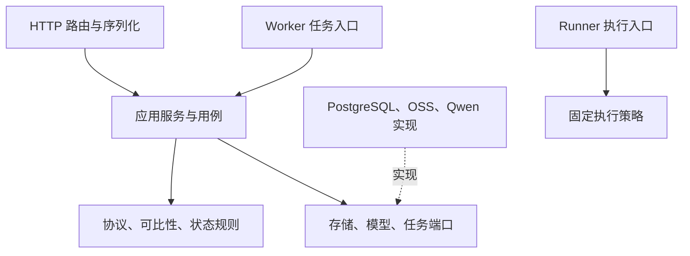
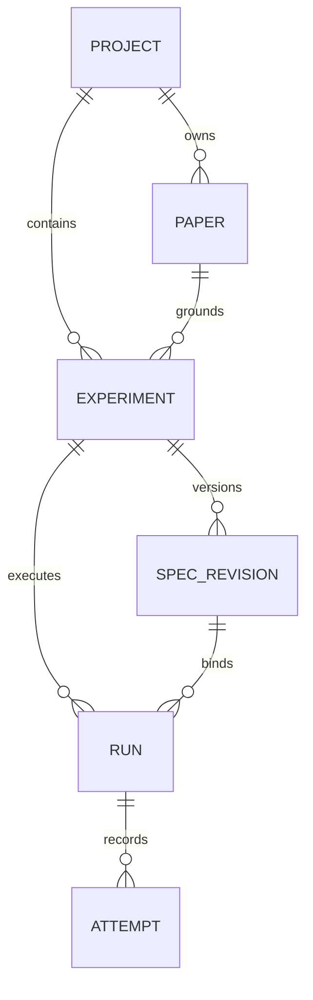

# Paper2Run 详细工程设计：模块与数据

_设计契约 v0.1，2026-09-19。本文细化上一版技术架构；没有代表工程已实现。适用范围为邀请制 CV 分类实验复现 MVP。_

---

> **总设计优先级：** 本文是数据库、模块、Worker、Runner 和持久化的专题细节，统一职责边界以 [Paper2Run 统一工程设计](11-Paper2Run统一工程设计.md) 为准。旧的“Qwen 生成代码/网关”简称应理解为 Framework Service 通过 OpenAI-compatible Provider 调用模型，不表示首版维护 Qwen 专用适配器。

## 📋 文档边界与确定决策

入口文档：[总体技术架构](02-技术架构.md)、[比赛规则](01-比赛规则与交付清单.md)、[接口定义](06-接口定义.md)、[运行与部署](07-运行与部署.md)、[开发任务包](08-开发任务包.md)。

本次保持上轮产品方向：论文 PDF/arXiv → 有来源的结构化解析 → 用户确认实验协议 → Qwen 生成代码 → 隔离执行及有限修复 → 独立评测 → 可下载的证据报告。

不是通用聊天机器人，也不是任意代码托管平台。产品入口可以接收不同论文，但自动执行能力必须与能力目录中的 `recipe` 匹配。不支持时返回具体缺失条件，而非自动套用某个预置结果。

本版补齐并统一四项概念：

1. **Experiment 是实验意图及总预算容器；Run 是一次已获确认的运行。** 等待初始确认属于 Experiment，不提前创建一个占资源的 Run。
2. **Revision 是不可变实验协议。** 修改后新建 revision；历史确认保留，但只有当前 head 的有效确认能创建新运行。
3. **Attempt 是候选代码；Execution 是某个候选的一次具体进程执行。** 网络恢复不增加代码修复数，重新发一个补丁才增加。
4. **Report 是独立产物状态。** 运行结束不代表指标达标，报告渲染失败也不把训练历史改成失败。

采用模块化单体，不把每个模块都部署成服务。可部署单元只有 Web、API、Worker、Runner 和 PostgreSQL/对象存储等基础设施；指标计算由 Worker 中的可信纯程序完成，绝不加载生成的模型代码。

## 🎯 产品流程与页面设计

### 用户的一次真实操作

1. 创建项目，上传有权使用的 PDF，或输入 arXiv ID；明确同意将必要文本/页面交给所选 Qwen 服务。
2. 解析过程中可关闭页面。回来后从服务端状态恢复，不依赖页面计时器。
3. 选择论文中的一个具体实验：例如 Table 6 中 CIFAR ResNet-20，而不是泛泛选择“ResNet”。
4. 查看每个关键字段的原文证据、缺失值及工程假设，选择 `smoke/scaled/reference` 模式和预算。
5. 保存并确认协议。任何新修改均需重新确认；不能确认后暗中替换数据集。
6. 启动新运行，查看真实代码、日志、补丁、资源使用和终止原因。
7. 阅读结果：实验做了什么、哪些条件不同、指标来自哪里、是否有比较资格；下载代码与证据包。

### 页面路由与数据来源

| 路由 | 主职责 | 首要操作 |
|---|---|---|
| `/login` | 邀请登录、会话提示 | 登录 |
| `/projects` | 列表、真实任务历史 | 创建项目 |
| `/projects/:id` | 文件与项目概览 | 上传论文 |
| `/papers/:id/review` | 原文证据与协议编辑 | 保存并确认 |
| `/runs/:id` | 实时状态、代码和日志 | 取消运行 |
| `/runs/:id/report` | 比较结论与证据 | 导出 |

界面仍按原型的工作台、解析确认、执行、报告四大视图组织，URL 支持直接访问和刷新恢复。论文预览读取实际 PDF/页面，不能把原型中的装饰线条伪装成原文。

前端功能目录：`features/projects`、`papers`、`specs`、`runs`、`reports`、`auth`。跨模块共享仅限 `ui`、`api-client`、`contracts`、`formatters`。TanStack Query 保存服务端状态；表单局部状态保留未提交编辑；SSE 只更新缓存，不充当唯一数据源。

## 📦 模块边界与内部接口

### 分层和依赖方向



约束：Domain 不 import FastAPI、OpenAI SDK、Docker SDK 或 SQLAlchemy；路由不直接调用模型、不启动容器；数据访问在 repository 内；共享 schema 不夹带业务副作用。避免“所有东西放进 utils.py”以及每个模块自行建立数据库连接。

### 模块责任清单

| 模块 | 负责 | 禁止承担 |
|---|---|---|
| `identity` | 邀请、会话、角色 | 业务数据跨项目放行 |
| `projects` | 项目成员与资源归属 | 绕开子资源权限 |
| `ingestion` | 上传、受控下载、文件校验 | 执行论文内命令 |
| `paper_parser` | 页面、字段、证据定位 | 用常识补造实验参数 |
| `experiment` | 协议、确认、可比性 | 自动放宽评分目标 |
| `orchestration` | 状态、阶段、预算、恢复 | 自由执行模型命令 |
| `model_gateway` | Qwen 调用、格式与用量 | 修改领域规则 |
| `codegen` | 文件生成、补丁、方法断言 | 改固定评测器与镜像 |
| `execution` | 执行请求、Runner 对账 | 在 API 主机跑生成代码 |
| `evaluation` | 固定指标、覆盖率、比较 | import 生成模型 |
| `artifacts` | 清单、哈希、私有下载 | 以用户路径直接访问宿主 |
| `reporting` | 数字固化、解释、导出 | 从文本猜最终准确率 |

### 核心端口签名

以下为接口草图，类型以 API 合约为准；不是可直接复制运行的实现。

```python
class PaperParserPort(Protocol):
    async def extract(self, paper: PaperRef, policy: ParsePolicy) -> Extraction: ...

class ModelGatewayPort(Protocol):
    async def call(self, request: ModelRequest) -> ModelResult: ...

class ExperimentService(Protocol):
    async def save_revision(self, command: SaveRevision, actor: Actor) -> SpecRevision: ...
    async def confirm(self, command: ConfirmRevision, actor: Actor) -> Confirmation: ...
    async def start(self, command: StartRun, actor: Actor) -> Run: ...

class ExecutionPort(Protocol):
    async def request(self, spec: ExecutionDescriptor) -> ExecutionRef: ...
    async def inspect(self, execution_id: str) -> ExecutionSnapshot: ...
    async def cancel(self, execution_id: str, reason: str) -> CancelAck: ...

class ArtifactStorePort(Protocol):
    async def put_staged(self, source: BinarySource, quota: int) -> StagedArtifact: ...
    async def finalize(self, artifact: StagedArtifact, manifest: ArtifactManifest) -> Artifact: ...
    async def get_authorized(self, artifact_id: str, actor: Actor) -> ArtifactAccess: ...

class MetricEvaluatorPort(Protocol):
    def evaluate(self, predictions: PredictionBatch, labels: LabelSet,
                 spec: EvaluationSpec) -> VerifiedMetrics: ...
```

事务通过应用层 `UnitOfWork` 管理；不要在领域方法里隐式 commit。模型和 Runner 等外部调用发生在短事务之外，结果回来后使用版本号/租约校验再写回。

### Qwen 适配器输入输出

`ModelRequest` 固定字段：call_id、purpose（`extract/plan/generate/repair/explain`）、model_config_id、prompt_version、input_parts（受控文本/页面图像）、output_schema_id、max_output_tokens、timeout_seconds、budget_reservation_id。调用方只传这些数据，不传任意工具列表或系统权限指令；模型选择必须属于管理员验证的 capability 配置。

`ModelResult` 固定字段：call_id、provider_request_id、resolved_model、status、structured_output、usage（input/output/cache tokens 可空）、elapsed_ms、finish_reason、error_code。记录响应 hash 与必要的脱敏原始输出用于格式诊断，不能公开模型内部推理或凭据。

任务 Qwen 输出边界：抽取返回 ExtractionDraft；规划返回分阶段 PlanDraft；生成返回允许路径的 GeneratedFiles；修复返回 PatchProposal（base_code_hash、文件 diff、解释证据、是否涉及协议语义）；解释返回按 evidence_id 引用的文字。它们统一做本地 schema 校验，模型原生 JSON 能力只作为帮助，不作为可信性保证。

暂时网络/429/5xx 最多两次基础设施重试并受总预算约束；401/403/不可用模型是配置错误，不进入代码修复。格式不符最多两次输出格式修正，每次记模型调用并扣预算；预算不足即停止。截断响应不当完整文件写入代码清单。模型修复 proposal 若 base_code_hash 与当前候选不符则拒绝应用。

同一论文按页/节组织证据片段，用确定性章节检索加 Qwen 判读；首版不引入向量检索服务。上下文只包含当前阶段所需原文、协议、相关代码与有界错误日志，不把全部历史输出无限追加。

### Recipe 不是预置答案

`recipes/cv_classification/<id>/<version>/` 包含：

- 支持任务和数据集标识，允许模型接口和文件路径
- 已审查的数据获取/预处理与 split policy
- 镜像 digest、Python/PyTorch 兼容组合、固定入口和资源策略
- 模型 `forward` 输入输出约束、shape/assertion 和检查点加载规范
- 受保护评测器版本、指标定义、原文与执行协议映射规则
- 能力测试及已知限制

不包含“某论文必然得 93.72%”的成功结果。算法代码由 Qwen 依据确认协议生成；数据和评价接口是平台提供，报告必须披露哪些文件是模板、哪些是生成内容。增加新 recipe 是可审阅的维护操作，不是模型临时联网下载插件。

## 💾 领域数据与持久化设计

### 核心关系



论文物理文件可做租户内去重，但不同项目的权限和删除记录不能共用。数据库 ID 为不透明、带资源前缀的字符串；前端不能从 ID 推导路径、数量或权限。

### 表与主要约束

| 表 | 主要字段 | 关键约束 |
|---|---|---|
| `users` | id、display_name、disabled_at | 禁用即拒绝新会话 |
| `sessions` | token_hash、user_id、expires_at、last_seen_at | 只存令牌哈希 |
| `project_members` | project_id、user_id、role | 二者联合唯一 |
| `projects` | id、name、owner_id、deletion_state | 所有权非空 |
| `papers` | project_id、artifact_id、sha256、version、status | 上传记录独立 |
| `extractions` | paper_id、schema_version、content、source_hash | 输出不可变 |
| `experiments` | paper_id、head_revision_id、budget_limit、repair_count | 一个实验意图 |
| `spec_revisions` | experiment_id、revision_no、spec_hash、content | 实验内版本唯一 |
| `confirmations` | revision_id、actor_id、spec_hash、policy_hash | 绑定精确版本 |
| `runs` | experiment_id、revision_id、parent_run_id、state、version | 一个活动 run/实验 |
| `attempts` | run_id、attempt_index、repair_ordinal、code_hash | run 内编号唯一 |
| `executions` | attempt_id、phase、lease_epoch、state、handle | 每阶段最多一个活跃执行 |
| `jobs` | stage、input_hash、lease_owner、lease_until、fence | 幂等键唯一 |
| `run_events` | run_id、seq、type、payload、created_at | run 内 seq 唯一 |
| `artifacts` | owner_scope、storage_key、sha256、bytes、state | 只能 finalized 下载 |
| `metric_results` | run_id、evaluator_version、payload_hash、content | 不接受用户覆盖 |
| `reports` | run_id、version、status、content_hash、content | 历史报告不可变 |
| `budget_entries` | scope、operation_key、reservation、actual、state | operation_key 唯一 |
| `operations` | kind、resource_id、status、error | 对外异步状态 |
| `idempotency_keys` | user_id、method、path、key_hash、body_hash | 同域唯一 |

SQL 类型建议：`timestamptz`、`bigint` 用于序号/字节、`numeric` 用于金额，状态 text 加 CHECK、不可变结构用 JSONB 并带 schema version。不能用浮点数记录货币。数据库 JSONB 并不替代应用 schema 校验。

建议索引：项目更新时间排序；`jobs(status, available_at)`；活动租约截止；`run_events(run_id, seq)`；`artifacts(project_id, run_id)`；`runs(project_id, created_at, id)`。运行列表用稳定 cursor，不采用深层 OFFSET。

通用 job 幂等键为 `(resource_type, resource_id, stage, input_hash)`：paper 解析绑定 paper/extraction，运行阶段绑定 run，导出绑定 export。上轮的 `(run_id,stage,input_hash)` 是运行阶段的特例，不能要求尚无 run 的上传任务伪造 run_id。input_hash 纳入对应 revision/attempt/recipe/evaluator 等版本，只有输入完全相同才复用阶段产物。

### 三份真相和哈希

- `PaperSpec/Extraction`：原文描述。字段带 `value`、`source_refs`、`evidence_status` 和缺失原因。
- `ExperimentSpec`：用户确认的计划。包括原文值、用户改动、运行模式、recipe、预算及比较目标。
- `RunManifest`：实况。包括实际代码/镜像/数据/预测/评测 hash、模型版本、阶段和失败记录。

`spec_hash = SHA256(canonical_json(spec))`。canonical serialization 采用 RFC 8785/JCS，固定实现版本并做跨语言 fixture；时间为规范字符串，货币/字节为安全范围整数，浮点禁止 NaN/Infinity，非法数在校验阶段拒绝。前端只使用服务端返回的 hash，不自己推测。确认人、确认时间和文案不写入 spec 自身；它们在 confirmation 中。JCS 规范参见 RFC 8785。[^1]

source ref 最少含：paper_id、1-based page、section/table/row 可选、摘录、归一化 bbox `[x0,y0,x1,y1]`、PDF sha256；坐标原点为页面旋转校正后的左上角，范围 0–1。页码和坐标必须对应同一原文件版本。

### 文件与数据库双写

文件先上传到不可公开的 staging key，计算 hash/大小并验证，再在短事务中写 artifact finalized 和下一阶段 job。失败事务留下的孤儿 staging 由有界清理任务回收；对象成功上传不代表数据库已接受结果。

相反，数据库不提前把尚不存在的对象标 finalized。导出任务仅引用 finalized 清单；缺少 artifact 时返回可解释失败，不生成内容不完整却称“可复现”的 ZIP。

## 🔄 生命周期、调度与故障恢复

### 状态枚举

| 对象 | 状态 |
|---|---|
| Paper | `uploaded / parsing / ready / failed / unsupported` |
| Experiment | `draft / ready / active / needs_revision / closed` |
| Run | `queued / generating / executing / repairing / verifying / cancel_requested / completed / failed / cancelled / awaiting_revision` |
| Report | `pending / generating / ready / failed` |
| Operation | `queued / running / succeeded / failed / cancelled` |

Experiment 生命周期：新建 draft；当前 head 已有效确认为 ready；存在活动 run 为 active；最近 run awaiting_revision 为 needs_revision；完成/失败/取消且不再派生时为 closed。Run 是运行事实，Experiment 是聚合摘要；状态更新同事务维护，不能靠前端独立拼装。

Run 的终态为 `completed/failed/cancelled/awaiting_revision`。`awaiting_revision` 表示该 run 已停止，实验还等待新协议；用户确认新 revision 后新建派生 run，不能把原 run 改回 queued。

原文指标是否匹配由另一个 verdict 表达：`matched / outside_tolerance / not_comparable / execution_failed / insufficient_evidence`。`smoke/scaled` 完成时通常是 `not_comparable`，不是 `matched`。

### 有限阶段流水线

公共 job stage 固定为：`paper_ingest`、`paper_extract`、`plan_build`、`code_generate`、`code_validate`、`smoke_execute`、`train_execute`、`predict_execute`、`metrics_verify`、`repair_propose`、`report_build`、`export_build`、`project_purge`。

stage 与 Run.status 映射：首次 plan/code generate/validate 为 generating；smoke/train/predict 为 executing；repair_propose 与修复后 code_validate 为 repairing；metrics_verify 为 verifying；report/export 独立作业不回退已终态 Run。paper/project 作业没有 Run，使用所属 resource 的状态和 Operation。当前 stage 必须能与 status 一致，过期 stage 结果不能写入新的 attempt。

模式决定阶段：smoke 跳过全量 train；reference 先 smoke 再 train，但 smoke 步骤不计入原文训练计划。正式训练始终从定义的初始状态开始，不隐式继承 smoke 更新后的权重。训练 checkpoint 恢复必须协议允许，并记录 checkpoint hash、RNG/optimizer/scheduler 状态及已完成步数。

一次成功阶段在同一事务提交状态变化、event 和下一阶段 job；不能“更新数据库后再尽力发队列消息”。PostgreSQL 本身就是首版持久任务队列。

### 修复次数与预算

`attempt_index` 在每个 run 从 0 开始；整个 experiment 的 `repair_ordinal` 为 1–5，派生 run 不重置。派生 run 在新确认协议下生成的新候选也消耗一个 repair_ordinal，不能当作免费“首次生成”。因此“最多六个候选”指实验链中的首次候选加五次修复，不是每个派生 run 各六次。首个 run 之后只允许从最近的 awaiting_revision 终态派生；已完成/取消后主动重跑作为新 experiment，并受账户总预算限制。

基础设施故障重试：同一代码、同一输入、同一阶段最多两次；有新的 `execution_id` 并消耗剩余时间/费用，不增加 repair_ordinal。不能在 GPU 原进程状态未知时立即重试。

预算分三个作用域：上传解析用 project/account 额度；生成和执行用 experiment 总额度；每 run 设置不超过总余额的子上限。新建同论文实验不能绕过账户日上限。每次调用前锁预算行并预留最坏可估用量，结束后结算；未知账单保留 reservation 等待对账，不能释放成零费用。

### 崩溃和取消处理

Worker job 心跳建议 10 秒、租约 60 秒；Runner execution 心跳 5 秒、租约 30 秒，失联到期再加最多 10 秒停止宽限。所有数值在配置中统一，需压力/故障测试后调整。

每次租约领取递增 fence/epoch，旧持有者不能写正式状态或正式 artifact。Runner 以 execution_id 查询已有容器，不重复创建。Worker 重启先对账 Runner，不盲目重新生成代码或从头训练。资源 watchdog/reaper 必须独立于 Runner 主循环，由宿主管理器监管；即使 Runner 进程崩溃，也要按 execution 标签、已验证租约和墙钟上限停止遗留容器。

取消是请求而不是立即成功。API 202 返回 `cancel_requested`；Runner 发停止并确认退出，之后才记 cancelled 和释放槽位。completed/failed 等终态不被迟到取消覆盖。失联时按 watchdog 停止并等待对账；前端明确显示“停止确认中”，不得说已经停止计费。

## 🔐 信任与通信边界

### Runner 采用主动拉取

Worker 在数据库登记受控 execution；Runner 主动通过 mTLS 连接内部 API 拉取租约。没有公网 Docker 端口，浏览器不直接访问 Runner。API 不解析或接受用户提供的 shell/docker 参数。

Runner 接收签名描述：execution_id、attempt_id、lease_epoch、recipe ID/version、镜像 digest、允许输入 hash、固定 phase、资源上限和有效期。传输下载能力短期且限定对象；容器中不注入 Runner 凭据、下载 token 或 Qwen Key。

Runner 拉取和完成协议见 [接口文档的内部接口](06-接口定义.md)。部署还需用防火墙和宿主目录权限限制 Runner；应用 token 不是操作系统隔离替代品。

### 三阶段评测隔离

训练箱接收训练/允许验证数据；预测箱只接收评测输入；固定评测器在可信域持有标签、检查所有 sample_id 覆盖并计算指标。预测模型代码始终在隔离箱执行，固定评测器只解析限长数据文件。

真实运行不把 label 文件挂给预测箱，不把 stdout 当作最终指标，不允许模型写出 `metrics.json` 就视为通过。公开测试数据可能已被外部知晓，报告不宣称这等价于防作弊认证。

## ✅ 成品验收和扩展点

### 可交付成品的定义

两位有权限的队员能从同一系统分别创建项目；互不越权。新论文上传能产生新协议和新运行。网页关闭后任务继续；重开能看到进度。取消和超时可清理资源；失败能导出诊断。独立评测出真实数字，不可比较时清楚拒绝。干净环境能按固定说明重放支持案例。

UI 原型观感、Qwen logo 和终端动画都不是以上能力的替代。首版必须完整履行 F1–F8，但其“任意论文/镜像导出”范围按总体架构收敛并披露。

### 可扩展但暂不实现

- 新任务类型以 recipe/evaluator/contract 版本扩展，不在 orchestration 塞一串论文名称分支。
- 更多 Runner 通过注册身份和 capability 调度扩展；GPU slot 显式分配。
- 未来换任务队列时保留 DB 状态和幂等键，只替换领取实现。
- 未来增加模型供应商时扩展 ModelGateway；本届选定赛题路径仍保持 Qwen 真实参与。
- 开放匿名、多租户、任意依赖/仓库执行需要单独安全设计，不在 MVP 默认权限里悄悄开放。

[^1]: RFC Editor，RFC 8785: JSON Canonicalization Scheme (JCS)，检索 2026-09-19。https://www.rfc-editor.org/rfc/rfc8785 。
