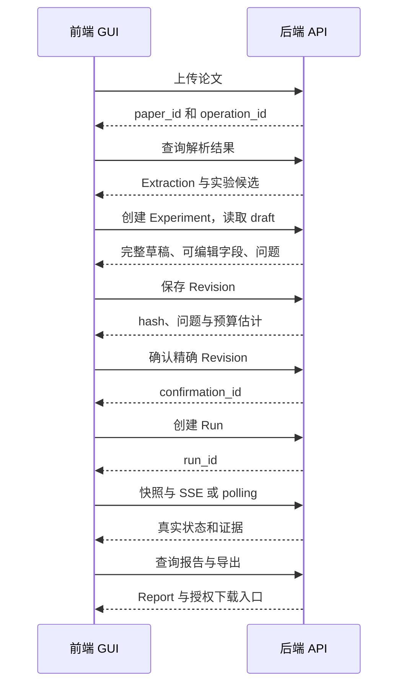

# Paper2Run 前后端公共接口契约

_联调基线 v0.2 · 2026-09-19 · 后端负责人：你；前端 GUI 负责人：队友。本文只定义浏览器可调用的公共 API，不包含 Runner 内部协议。_

---

> **总设计优先级：** 本文继续作为浏览器 `/api/v1` 公共 DTO 和联调契约的专题标准；整体工程、Framework Service、Provider、Worker、Runner 和内部 API 边界以 [Paper2Run 统一工程设计](11-Paper2Run统一工程设计.md) 为准。

## 📋 阅读顺序与契约地位

前端先读 [GUI 交接说明](10-前端GUI交接说明.md)，再按页面查本文。本文中的 TypeScript 是**通信 DTO 定义**，不是产品实现；JSON 示例为 Mock 演示，不是论文实测。现阶段项目只有设计和静态原型，没有在线 API、Swagger 或可运行后端。

**公共接口以本文 v0.2 为准。** 项目原有 `06-接口定义.md` 保留设计背景和内部协议，公共字段不再作为第二份标准。实现后后端维护 Pydantic → OpenAPI → TypeScript 生成链，并与本文同步；前端只消费生成类型，不另维护不同的 Run/Report 类型。

本版在原规划上补齐必要读取接口：项目下 paper/experiment 列表、实验初始 draft、run curves、run exports 列表。它们用于页面刷新恢复、表单初始化、曲线与下载入口，不改变产品范围。下列所有路径省略公共前缀 **`/api/v1`**。

### 两人共同遵守

- 后端负责 ID、hash、权限、实验判断、任务状态、数字和评分；前端负责输入、展示、交互及状态反馈。
- 禁止前端直连 Qwen、OSS 管理接口、数据库、Docker 或 `/internal/v1`；浏览器不接触模型 Key。
- 除明确的可编辑字段外，前端原样保留服务端协议字段，不自行补默认算法配置。
- 字段不匹配时先修契约再改双方，不在组件里长期写多套字段名兼容。
- 下文 `ID/Hash/UtcTime` 都是字符串；字节/序号/金额 micros 为 JavaScript 安全范围内整数；未知值是 `null`，不可显示为 0。

## 🌐 传输、鉴权和错误

### 基础约定

开发浏览器访问 `http://127.0.0.1:5173`，前端 dev proxy 将 `/api/v1` 转至 `http://127.0.0.1:8000`；正式环境同源 HTTPS。上述地址是拟实现配置，当前未启动。团队不要混用 localhost 和 127.0.0.1，也不要硬编码队友电脑 IP 到组件。

JSON 请求 `Content-Type: application/json`；multipart 上传由浏览器自己生成 Content-Type/boundary。所有请求携带同源 cookie。生产 session 为 HttpOnly/Secure/SameSite=Lax；前端不读 cookie、不保存 session token 到 localStorage。

除登录外的写请求带 `X-CSRF-Token`，由 `/auth/me` 取得并仅保存在内存。登录检查 Origin/限流。任何 401 均停止当前查询循环、关闭 SSE、保留当前页面内存中的表单并引导登录；不把论文内容或邀请 token 存入浏览器长期缓存。

```typescript
export type ID = string;
export type Hash = string; // 服务端实际返回64位十六进制SHA-256
export type UtcTime = string; // ISO 8601 UTC
export type JsonValue = string | number | boolean | null | JsonValue[] | { [key: string]: JsonValue };
export type Role = 'owner' | 'editor' | 'viewer';
export type DataMode = 'mock' | 'live' | 'replay';
export type ExperimentMode = 'smoke' | 'scaled' | 'reference';
export interface Meta { request_id: string }
export interface Ok<T> { data: T; meta: Meta }
export interface Page<T> extends Ok<T[]> {
  page: { next_cursor: string | null; has_more: boolean };
}
export interface FieldError { path: string; code: string; message: string }
export interface ApiError {
  code: string;
  message: string;
  retryable: boolean;
  details: {
    field_errors?: FieldError[];
    operation_id?: ID;
    revision_id?: ID;
    latest_revision_id?: ID;
    [key: string]: JsonValue | FieldError[] | undefined;
  };
}
export interface Err { error: ApiError; meta: Meta }
```

对象成功返回 `Ok<T>`；分页列表返回 `Page<T>`；204 不解析 JSON；PDF、文本附件下载及 SSE 不套 envelope。服务器同时返回 `X-Request-ID`，方便联调定位。

所有列表默认 `limit=20`、最大 100、可选 opaque `cursor`，按 `(created_at DESC,id DESC)` 稳定排序；`cursor` 不能由前端生成。分页应用于项目、paper、experiment、revision、run、attempt、file 和 export 列表，见接口表。数组型 `curves.series`、报告指标和 source_refs 不另套分页，后端按产品限额返回有界集合。

### 幂等与重试

接口表中的 **K** 表示必须发送 `Idempotency-Key`（UUID），**C** 表示必须发送 CSRF。同一次用户操作的网络重试复用同一 key 和同一 body；用户修改输入后再提交必须生成新 key。禁止每次重试都新建 key 导致重复训练。

同 key/body 返回同资源；不同 body 返回 409；处理中返回 409 `IDEMPOTENCY_IN_PROGRESS` 和 `Retry-After`。后端至少保留 24h，并在重放前重新校验权限。超过有效窗口或结果不明，先读资源状态，不自动发起新收费操作。

GET 网络重试可 1/2/4 秒退避；写请求不盲目重试。403/422 由用户修正，429 遵循 `Retry-After`；未知错误显示 message 与 request_id。服务端 `retryable=true` 不是前端可无限自动重试的许可。

| HTTP | code | GUI 行为 |
|---|---|---|
| 401 | `SESSION_REQUIRED / SESSION_EXPIRED` | 停轮询/SSE，登录 |
| 403 | `FORBIDDEN / CSRF_FAILED / READ_ONLY_MODE` | 禁止操作或刷新会话 |
| 404 | `RESOURCE_NOT_FOUND` | 不显示跨项目资源存在性 |
| 409 | `REVISION_CONFLICT / POLICY_CHANGED / EVIDENCE_CHANGED` | 保留编辑并重新取草稿/版本 |
| 409 | `RUN_ACTIVE / REVISION_NOT_CONFIRMED` | 跳转已有运行或确认页 |
| 409 | `IDEMPOTENCY_CONFLICT / IDEMPOTENCY_IN_PROGRESS` | 检查 key/body 或等待 |
| 409 | `EVENT_CURSOR_EXPIRED` | 取新快照，恢复订阅 |
| 413/415 | `FILE_TOO_LARGE / UNSUPPORTED_MEDIA_TYPE` | 文件字段报错 |
| 422 | `SPEC_INVALID / UNSUPPORTED_RECIPE / BUDGET_EXHAUSTED` | 字段/预算说明，不启动 |
| 422 | `PAPER_PARSE_FAILED / REPORT_BUILD_FAILED` | 终止等待，展示失败证据 |
| 429 | `RATE_LIMITED / DAILY_QUOTA_EXCEEDED` | 倒计时或人工处理 |
| 503 | `MODEL_UNAVAILABLE / RUNNER_UNAVAILABLE` | 明确不可用，不自动切 Mock |
| 500 | `INTERNAL_ERROR` | 保留 request_id |

未知 code 采用通用 error banner，不能因未识别 code 崩溃。字段错误用 `details.field_errors[].path`（JSON pointer）关联表单，不解析中文 message。更具体的资源未就绪也用 409，如 `PAPER_NOT_READY`、`EXPORT_NOT_READY`、`EXPERIMENT_CLOSED`；缺少 If-Match 或内容冲突分别为 `PRECONDITION_REQUIRED`、`REVISION_CONFLICT`。这些情况均不自动重建资源。

## 🔐 身份、能力与资源导航

### DTO：账户、能力、项目与异步操作

```typescript
export interface SessionInfo {
  user: { id: ID; display_name: string };
  session: { expires_at: UtcTime; idle_expires_at: UtcTime };
  csrf_token: string;
  permissions: { can_create_project: boolean };
  memberships: { project_id: ID; role: Role }[];
}
export interface RecipeCapability {
  id: string; version: string; label: string;
  modes: ExperimentMode[]; dataset_ids: string[];
  execution_support: 'available' | 'unavailable'; reason: string | null;
}
export interface Capabilities {
  contract_version: '0.2';
  execution_backend: 'mock' | 'local' | 'remote'; data_mode: DataMode;
  writes_enabled: boolean;
  upload: { max_pdf_bytes: number; max_pages: number; arxiv_enabled: boolean };
  limits: { max_repairs: number; max_queued_runs_per_user: number };
  recipes: RecipeCapability[];
  models: { purpose: 'parse' | 'plan' | 'code'; display_name: string; available: boolean }[];
}
export interface Project {
  id: ID; name: string; description: string; role: Role;
  version: number; deletion_state: 'active' | 'deleting' | 'deleted';
  created_at: UtcTime; updated_at: UtcTime;
}
export interface ProjectCreate { name: string; description?: string }
export interface ProjectPatch { name?: string; description?: string }
export type OperationStatus = 'queued' | 'running' | 'succeeded' | 'failed' | 'cancelled';
export interface Operation {
  id: ID; kind: 'paper_ingest' | 'paper_extract' | 'report_build' | 'export_build' | 'project_purge';
  status: OperationStatus;
  resource: { type: 'paper' | 'report' | 'export' | 'project'; id: ID };
  stage: string | null;
  progress: { completed_units: number; total_units: number } | null;
  error: ApiError | null; updated_at: UtcTime;
}
export interface OperationAccepted { operation_id: ID; status: 'queued' | 'running' }
```

`stage` 在 Operation 上是展示用步骤标识，不与 Run.status 混用。没有可量化总量时 progress=null，显示阶段名而非虚假百分比。

### 接口表

| 方法/路径 | 请求 | 成功响应 | 权限/头 |
|---|---|---|---|
| `POST /auth/session` | `{invite_token:string}` | 201 `Ok<SessionInfo>` + cookie | 未登录；无 K/C |
| `GET /auth/me` | 无 | 200 `Ok<SessionInfo>` | 已登录 |
| `DELETE /auth/session` | 无 | 204 | 已登录/C |
| `GET /capabilities` | 无 | 200 `Ok<Capabilities>` | 已登录 |
| `GET /projects` | cursor/limit | 200 `Page<Project>` | 已登录 |
| `POST /projects` | ProjectCreate | 201 `Ok<Project>` | 获准成员/C/K |
| `GET /projects/{id}` | 无 | 200 `Ok<Project>` + ETag | 项目可读 |
| `PATCH /projects/{id}` | ProjectPatch | 200 `Ok<Project>` + ETag | owner/editor/C/If-Match |
| `DELETE /projects/{id}` | 无 | 202 `Ok<OperationAccepted>` | owner/C/K |
| `GET /operations/{id}` | 无 | 200 `Ok<Operation>` | 所属项目可读 |

name 1–120 字符，description 最多 2000 字符。PATCH 至少一字段，If-Match 必须用详情接口响应的 ETag 原串；缺少/冲突返回 409，不能自行拼 ETag。项目删除属于 P1 GUI，不阻塞首轮四页面联调。

邀请是一次性兑换，前端不自动重试登录。如果网络响应丢失，先 `/auth/me`，未获得会话则联系后端负责人重发邀请，不能凭幂等键取回 session secret。项目角色按具体项目判断；是否可创建新项目使用 `SessionInfo.permissions.can_create_project`，不能因某项目是 viewer 就推导全局身份。评委邀请默认该权限 false。owner/editor 执行权限还需 `writes_enabled=true`，后端永远二次校验。

## 📚 论文上传、原文和结构化解析

### DTO：Paper 与证据

```typescript
export type PaperStatus = 'uploaded' | 'parsing' | 'ready' | 'failed' | 'unsupported';
export interface Paper {
  paper_id: ID; project_id: ID; title: string | null;
  status: PaperStatus; sha256: Hash | null; arxiv_version: string | null;
  page_count: number | null; content_available: boolean;
  current_extraction_id: ID | null; active_operation_id: ID | null;
  processing_consent: { accepted_at: UtcTime; policy_version: string };
  error: ApiError | null; created_at: UtcTime;
}
export interface PaperAccepted {
  paper_id: ID; operation_id: ID; status: 'uploaded' | 'parsing';
}
export interface ArxivImport {
  source_type: 'arxiv'; arxiv_id: string; source_processing_consent: true;
}
export type EvidenceStatus = 'supported' | 'inferred' | 'missing' | 'conflicting';
export interface ExtractedField<T> { value: T | null; evidence_status: EvidenceStatus; source_refs: ID[] }
export interface SourceRef {
  id: ID; paper_id: ID; pdf_sha256: Hash; page: number;
  section: string | null; table: string | null; row: string | null;
  quote: string;
  bbox: [number, number, number, number] | null;
}
export interface CandidateExperiment {
  id: ID; label: string; source_refs: ID[];
  recipe_id: string | null; recipe_version: string | null;
  execution_support: 'supported' | 'requires_review' | 'unsupported';
  unsupported_reasons: string[];
}
export interface Extraction {
  extraction_id: ID; paper_id: ID; schema_version: '1.0';
  fields: {
    task: ExtractedField<string>; dataset: ExtractedField<string>; optimizer: ExtractedField<string>;
  };
  methods: { id: ID; label: string; source_refs: ID[] }[];
  formulas: { id: ID; latex: string; source_refs: ID[] }[];
  candidate_experiments: CandidateExperiment[]; source_refs: SourceRef[];
  warnings: string[];
}
```

bbox 是旋转校正后页面左上原点的归一化 `[x0,y0,x1,y1]`，0–1，页码从 1 开始。没有 bbox 只跳页并展示摘录，不生成假高亮。LaTeX 渲染关闭可执行/可信 HTML 功能。source_refs 必须指向该 extraction 的实际 source。

### 上传和查询

| 方法/路径 | 请求 | 成功响应 | 权限/头 |
|---|---|---|---|
| `GET /projects/{id}/papers` | cursor/limit | 200 `Page<Paper>` | 可读 |
| `POST /projects/{id}/papers` | FormData 或 ArxivImport | 202 `Ok<PaperAccepted>` | owner/editor/C/K |
| `GET /papers/{id}` | 无 | 200 `Ok<Paper>` | 可读 |
| `GET /papers/{id}/content` | 可选 Range | 200/206 PDF 字节 | 可读 |
| `GET /papers/{id}/extraction` | 无 | 200 `Ok<Extraction>`；202 `Ok<PaperAccepted>` | 可读 |
| `POST /papers/{id}/extractions` | `{reason:string}` | 202 `Ok<PaperAccepted>` | owner/editor/C/K |

FormData 字段：`file` 必需 PDF；`title_hint` 可选 string；`source_processing_consent` 以文本 `"true"` 编码。未勾选不发请求；后端拒绝缺失/false。JSON 导入使用真正 boolean true。前端可校验大小/扩展名帮助用户，后端负责魔数、页数、SSRF 与内容安全。

arXiv 接口只收规范 ID，例如 `1512.03385v1`；粘贴 arxiv.org 链接由 UI 提取 ID，不把任意链接交后端下载。纸张上传大小取 capabilities，不在多处写死 25 MiB。

导入返回 paper_id 后跳 `/papers/{id}/review`，轮询 Paper/Operation：2 秒开始，最多退避到 10 秒；ready 后取 Extraction；failed 或 Operation.failed 即停止等待并显示诊断。unsupported 若已有 current_extraction_id 仍允许查看解析，但禁执行；无 extraction 时显示支持范围。解析失败的 extraction GET 返回 422 `PAPER_PARSE_FAILED`；不支持且无解析为 422 `UNSUPPORTED_RECIPE`；有可读 extraction 则返回 200。请求重解析才产生新 operation，不在每次 GET 重新抽取。

支持 PDF 预览时使用带凭据的同源 content URL；content_available=false 显示“原文件不可用”，保留解析证据。该情况可能来自保留期，不等于前端故障。

## ⚙️ 实验草稿、保存、确认和启动

### 为什么必须分四步

**选候选创建 Experiment → 读取 Draft → 保存 Revision → 确认后启动 Run。** 前端不能自行从论文摘要拼出完整训练配置。后端 draft 必须返回完整结构，无法证实的值为 null，并附 blocking issue。

```typescript
export type ExperimentStatus = 'draft' | 'ready' | 'active' | 'needs_revision' | 'closed';
export interface BudgetLimit {
  max_model_calls: number; max_tokens: number; max_execution_seconds: number;
  max_artifact_bytes: number; currency: 'CNY'; max_cost_micros: number;
}
export interface Issue { code: string; message: string; path: string | null; severity: 'warning' | 'blocking' }
export interface ComparisonPrecheck { status: 'eligible' | 'not_comparable' | 'unresolved'; reasons: string[] }
export interface MetricTarget {
  id: ID; metric: string; unit: 'percent' | 'ratio' | 'count' | 'scalar';
  direction: 'lower' | 'higher'; reference_value: number | null;
  source_ref: ID | null; statistic: 'single_reported' | 'mean' | 'best' | 'unknown';
  tolerance: number | null; weight: number;
}
export interface ExperimentSpec {
  schema_version: '1.0'; paper_id: ID; extraction_id: ID; candidate_experiment_id: ID;
  recipe: { id: string; version: string }; mode: ExperimentMode;
  method: { family: string; variant: string | null; must_include: string[] };
  dataset: {
    id: string | null; version: string | null; split_policy_id: string | null;
    train_subset_fraction: number | null;
  };
  training: {
    seed: number | null; batch_size: number | null; max_steps: number | null;
    max_epochs: number | null; optimizer: string | null;
    learning_rate: number | null; weight_decay: number | null;
  };
  targets: MetricTarget[]; budget: BudgetLimit;
  recipe_config: { [key: string]: JsonValue };
  assumptions: { path: string; description: string; source_refs: ID[] }[];
  user_changes: { path: string; reason: string }[];
}
export interface EditableField {
  path: string;
  kind: 'integer' | 'number' | 'select' | 'boolean';
  label: string; required: boolean; nullable: boolean;
  min: number | null; max: number | null;
  options: { value: string | number | boolean; label: string }[] | null;
}
export interface SpecDraft {
  experiment_id: ID; base_revision_id: ID | null; policy_hash: Hash;
  spec: ExperimentSpec; editable_fields: EditableField[];
  issues: Issue[]; comparison_precheck: ComparisonPrecheck;
}
export interface Confirmation {
  confirmation_id: ID; revision_id: ID; spec_hash: Hash;
  confirmed_by: ID; confirmed_at: UtcTime;
}
export interface SpecRevision {
  id: ID; experiment_id: ID; revision_no: number; spec_hash: Hash; policy_hash: Hash;
  spec: ExperimentSpec; validation: { issues: Issue[] };
  comparison_precheck: ComparisonPrecheck;
  budget_estimate: { currency: 'CNY'; amount_micros: number | null; duration_seconds: number | null; basis: string };
  confirmation: Confirmation | null; is_current: boolean; created_at: UtcTime;
}
export interface Experiment {
  experiment_id: ID; project_id: ID; paper_id: ID; status: ExperimentStatus;
  head_revision_id: ID | null; active_run_id: ID | null; latest_run_id: ID | null;
  repairs_used: number; repairs_limit: number; created_at: UtcTime;
}
export interface ExperimentCreate {
  paper_id: ID; extraction_id: ID; candidate_experiment_id: ID;
  recipe_id: string; recipe_version: string;
}
export interface RevisionCreate { experiment_id: ID; base_revision_id: ID | null; spec: ExperimentSpec }
export interface RevisionConfirm {
  spec_hash: Hash; policy_hash: Hash; accepted_issue_codes: string[]; accept_budget: true;
}
export interface RunCreate {
  experiment_id: ID; spec_revision_id: ID; confirmation_id: ID; parent_run_id: ID | null;
}
export interface RunAccepted { run_id: ID; status: 'queued'; events_url: string; last_event_seq: number }
```

**字段语义：** training 的 max_steps/max_epochs 确认时二选一，未确认草稿可双 null；不能把 null 转空串发回。seed 整数，subset_fraction 在 `(0,1]`，预算为正整数且受后端上限约束。tolerance 正数且单位与指标一致；reference_value 缺失不得由前端补造。

`recipe_config` 包含调度器、momentum、初始化、预处理、增强、checkpoint 选择等高级配置，首版 GUI 只读展示关键摘要并原样回传。recipe_config 不能是空壳：后端负责完整性校验，缺必要值就禁止确认。front-end 仅实现 editable_fields 中且属于基本表单的路径；出现未知可编辑 path 则显示“不支持的配置项”，保留数据，不写一个任意 JSON 执行编辑器。

方法/数据集 ID 若允许编辑，只能从 options 选。修改数据集引起版本、split、预处理不一致时后端保存返回 blocking issue，前端不得悄悄替换一组相关值。主版本不做任意方法生成表单。

### 接口和按钮顺序

| 方法/路径 | 请求 | 成功响应 | 权限/头 |
|---|---|---|---|
| `GET /projects/{id}/experiments` | cursor/limit；可选 paper_id | 200 `Page<Experiment>` | 可读 |
| `POST /projects/{id}/experiments` | ExperimentCreate | 201 `Ok<Experiment>` | owner/editor/C/K |
| `GET /experiments/{id}` | 无 | 200 `Ok<Experiment>` | 可读 |
| `GET /experiments/{id}/draft` | 无 | 200 `Ok<SpecDraft>` | 可读 |
| `GET /experiments/{id}/revisions` | cursor/limit | 200 `Page<SpecRevision>` | 可读 |
| `POST /projects/{id}/spec-revisions` | RevisionCreate | 201 `Ok<SpecRevision>` | owner/editor/C/K |
| `GET /spec-revisions/{id}` | 无 | 200 `Ok<SpecRevision>` | 可读 |
| `POST /spec-revisions/{id}/confirm` | RevisionConfirm | 201 `Ok<Confirmation>` | owner/editor/C/K |
| `POST /projects/{id}/runs` | RunCreate | 202 `Ok<RunAccepted>` | owner/editor/C/K |

Draft GET 是确定性组装已有 Extraction/recipe/head，不调用 Qwen、不收费、不创建新 revision。已有 head 则基于该版本返回草稿，首次基于选定 candidate。刷新页面使用列表/experiment_id 恢复，不因 React mount 再 POST 一个实验。candidate 的 recipe_id/version 为 null 或 execution_support=unsupported 时只能查看解析，不提交 ExperimentCreate；requires_review 且有 recipe 才可进入草稿，由 blocking issue 管住确认。

建议 UI 两个按钮：“保存并检查”和“确认并运行”。后一个内部依次 confirm → runs，**各用不同幂等 key**。确认成功但 runs 失败时保留 confirmation_id，重试 runs，而非重新创建 Experiment。保存后的本地编辑未提交时，禁用确认按钮。

blocking issues 存在时不能确认；warning 的接受列表必须显示给用户。保存 409 时保留内存编辑副本并提供重新读取最新版本，不自动覆盖队友修改。后端返回最新 hash 后才能确认，前端绝不自己算 hash。

协议语义改变导致 `awaiting_revision` 后，原 Run 不复活。只允许以最近 awaiting_revision Run 为 parent 新建派生 Run，继续消耗同一实验的总预算和修复数。已完成实验重复运行需要新 Experiment。

## 🔄 运行快照、文件、曲线与 SSE

### DTO：运行与代码

```typescript
export type RunStatus = 'queued' | 'generating' | 'executing' | 'repairing' | 'verifying'
  | 'cancel_requested' | 'completed' | 'failed' | 'cancelled' | 'awaiting_revision';
export type RunStage = 'plan_build' | 'code_generate' | 'code_validate' | 'smoke_execute'
  | 'train_execute' | 'predict_execute' | 'metrics_verify' | 'repair_propose';
export type ReportStatus = 'pending' | 'generating' | 'ready' | 'failed';
export interface RunBudget {
  currency: 'CNY'; limit_micros: number; actual_micros: number | null;
  reserved_micros: number; unknown_charges: boolean;
}
export interface Run {
  id: ID; project_id: ID; paper_id: ID; paper_title: string | null;
  experiment_id: ID; spec_revision_id: ID; parent_run_id: ID | null;
  status: RunStatus; stage: RunStage | null; version: number;
  last_event_seq: number; attempt_index: number | null;
  repairs_used: number; repairs_limit: number;
  mode: ExperimentMode; data_mode: DataMode;
  budget: RunBudget;
  resources: {
    cpu_millicores: number | null; ram_limit_bytes: number | null;
    gpu_slot: string | null; gpu_memory_used_bytes: number | null;
  };
  report_status: ReportStatus; terminal_reason: { code: string; message: string } | null;
  created_at: UtcTime; started_at: UtcTime | null; ended_at: UtcTime | null;
}
export interface Attempt {
  id: ID; run_id: ID; attempt_index: number; repair_ordinal: number;
  status: 'generated' | 'validating' | 'running' | 'failed' | 'succeeded';
  code_hash: Hash; code_manifest_id: ID;
  patch_artifact_id: ID | null; parent_attempt_id: ID | null;
  error_summary: { code: string; message: string } | null;
  diagnosis_summary: string | null; evidence_artifact_ids: ID[];
  log_artifact_ids: ID[]; created_at: UtcTime;
}
export interface CodeFile { path: string; artifact_id: ID; bytes: number; sha256: Hash; media_type: string }
export interface TextChunk {
  artifact_id: ID; text: string; offset: number; next_offset: number; eof: boolean;
}
export interface CurveSeries {
  id: ID; name: string; source: 'measured' | 'paper_digitized';
  metric: string; unit: string; x_axis: 'step' | 'epoch' | 'elapsed_seconds';
  points: { x: number; y: number | null }[]; evidence_artifact_id: ID;
}
export interface RunCurves {
  run_id: ID; attempt_id: ID | null; series: CurveSeries[];
  downsampled: boolean; warnings: string[];
}
```

Run 列表返回相同 Run DTO，首版无需另写缩略字段兼容层。attempt_index 为 null 说明还没生成第一候选；repair_ordinal=0 为初始候选，整个 Experiment 最多到 5。运行次数与修复次数不是一个数字。

Curve 是过程观测，最终指标仍以 Report 为准。曲线 GET 无数据返回空数组，不造平滑曲线；每条 series 最多 2000 点，服务端降采样时标 downsampled。论文只有原图、未可靠提取数值时不返回 paper_digitized series。x_axis/单位不同只能并排显示，不能自动叠加。

### 读取与取消接口

| 方法/路径 | 请求 | 成功响应 | 权限/头 |
|---|---|---|---|
| `GET /projects/{id}/runs` | cursor/limit；可选 status | 200 `Page<Run>` | 可读 |
| `GET /runs/{id}` | 无 | 200 `Ok<Run>` | 可读 |
| `POST /runs/{id}/cancel` | `{reason?:string}` | 202 `Ok<{run_id:ID;status:'cancel_requested'}>`；已终态 200 `Ok<Run>` | owner/editor/C |
| `GET /runs/{id}/attempts` | cursor/limit | 200 `Page<Attempt>` | 可读 |
| `GET /attempts/{id}/files` | cursor/limit | 200 `Page<CodeFile>` | 可读 |
| `GET /artifacts/{id}/text` | offset=0；limit≤65536 | 200 `Ok<TextChunk>` | 可读 |
| `GET /runs/{id}/curves` | 可选 attempt_id；max_points≤2000 | 200 `Ok<RunCurves>` | 可读 |
| `GET /runs/{id}/events` | after≥0 | 200 `text/event-stream` | 可读 |

不传 curves.attempt_id 时返回当前/最近候选的曲线，禁止跨候选拼成一条训练轨迹。text.offset/next_offset 是 UTF-8 字节位置，不是 JS 字符串长度，后续请求必须使用 next_offset。code/log 预览只读，禁止浏览器执行生成代码。

取消请求后保持“正在停止”，以 Run 终态为准；不要因 202 就显示“已取消”。取消/完成竞态以服务端返回终态为准，不本地强行改写。

### SSE 事件 DTO

```typescript
export interface EventPayloadMap {
  'stage.changed': { from: RunStatus; to: RunStatus; stage: RunStage | null; run_version: number };
  'artifact.created': { artifact_id: ID; kind: string; bytes: number; sha256: Hash };
  'attempt.failed': { attempt_id: ID; execution_id: ID; error_code: string; retry_class: 'repairable' | 'needs_revision' | 'terminal'; log_artifact_id: ID | null };
  'patch.proposed': { from_attempt_id: ID; new_attempt_id: ID; patch_artifact_id: ID };
  'budget.updated': RunBudget;
  'metric.verified': { metric_result_id: ID; evaluator_version: string };
  'run.terminal': { status: 'completed' | 'failed' | 'cancelled' | 'awaiting_revision'; terminal_reason: Run['terminal_reason']; report_status: ReportStatus };
  'report.ready': { report_id: ID; version: number; content_hash: Hash };
  'log.chunk': { execution_id: ID; attempt_id: ID; stream: 'stdout' | 'stderr' | 'system'; offset: number; next_offset: number; text: string; truncated: boolean };
}
export type EventName = keyof EventPayloadMap;
export type RunEvent<K extends EventName = EventName> = {
  [P in K]: {
    schema_version: '1.0'; run_id: ID; seq: number; type: P;
    occurred_at: UtcTime; payload: EventPayloadMap[P];
  }
}[K];
```

SSE 外层 `id` 为 seq 十进制，`event` 等于 JSON.type：

```text
id: 18
event: attempt.failed
data: {"schema_version":"1.0","run_id":"run_mock01","seq":18,"type":"attempt.failed","occurred_at":"2026-09-19T10:00:00Z","payload":{"attempt_id":"att_mock01","execution_id":"exe_mock01","error_code":"SHAPE_MISMATCH","retry_class":"repairable","log_artifact_id":"art_log01"}}

```

推荐先完成 polling，再增加 SSE：

1. GET Run，取得 snapshot 和 last_event_seq，同时 GET attempts/curves 等需要的历史资源。
2. 订阅 events?after=last_event_seq；只接受 `seq > last_applied_seq`。初次不指望 SSE 把历史日志全部补齐。
3. 状态/patch/artifact/metric/report 事件用于刷新相关 Query；日志事件限长追加。Run 状态以较新 version 快照校准，不靠定时器前进。
4. 断线 1/2/4 秒退避至 15 秒。恢复后携带最后实际处理的 seq；原生 EventSource 自动重连时 Last-Event-ID 优先。
5. **优先使用可读 HTTP 状态的 fetch-based SSE client**，便于识别 401/409；若用原生 EventSource，onerror 先关闭自动重试，再检查 `/auth/me` 和最新 Run，不能从 onerror 猜具体状态码。
6. 收到 409 cursor expired，重新取快照及历史资源，并提示“日志已恢复至当前状态”；不把缺失区段伪造为实时日志。
7. SSE 不可用则每 3 秒 GET Run，后台标签页放慢至 10 秒。终态停止 Run 高频 polling，但 report pending/generating 要继续轮询报告，不能错过异步报告完成。
8. 离开运行页关闭连接。每页每 run 只留一个连接。日志最多保留最近 2000 行/约 1 MiB 的有界视图；完整日志从 artifact 下载。

注释心跳每约 15 秒，不占 seq；未知事件忽略并刷新快照，不能令页面崩溃。replay 不订阅实时事件，仅展示历史数据。

## 📊 报告、复现声明与导出下载

### DTO：报告与导出

```typescript
export type Verdict = 'matched' | 'outside_tolerance' | 'not_comparable' | 'execution_failed' | 'insufficient_evidence';
export interface MetricRow {
  id: ID; name: string; unit: 'percent' | 'ratio' | 'count' | 'scalar';
  reference_value: number | null; observed_value: number | null;
  delta_absolute: number | null; delta_relative: number | null;
  tolerance: number | null; comparable: boolean; within_tolerance: boolean | null;
  source_ref: ID | null; evidence_artifact_ids: ID[];
}
export interface Report {
  id: ID; run_id: ID; version: number; mode: ExperimentMode; data_mode: DataMode;
  verdict: Verdict; comparison_reasons: string[];
  score: { policy_version: string; metric_match: number | null; process: number; environment: number; total: number | null };
  metrics: MetricRow[];
  evidence: { spec_revision_id: ID; manifest_artifact_id: ID; metric_result_id: ID | null };
  limitations: string[]; created_at: UtcTime;
}
export interface ReportPending {
  run_id: ID; status: 'waiting_for_run' | 'generating'; operation_id: ID | null; retry_after_ms: number;
}
export interface RunManifest {
  run_id: ID; status: 'provisional' | 'finalized'; schema_version: '1.0';
  spec_hash: Hash; paper_sha256: Hash; code_sha256: Hash | null; image_digest: string | null;
  seed: number | null; dataset: { id: string; version: string; sha256: Hash; split_sha256: Hash } | null;
  environment: { python: string | null; torch: string | null; cuda: string | null; gpu: string | null; driver: string | null };
  models: { purpose: string; model_id: string; prompt_version: string }[];
  evaluator_version: string | null;
  artifacts: { artifact_id: ID; kind: string; bytes: number; sha256: Hash }[];
  limitations: string[];
}
export type ExportFormat = 'bundle_zip' | 'report_pdf' | 'report_markdown' | 'report_json';
export interface ExportCreate { formats: ExportFormat[]; include_checkpoint?: boolean }
export interface ExportAccepted { export_id: ID; operation_id: ID; status: 'queued' }
export interface Export {
  id: ID; run_id: ID; status: 'queued' | 'running' | 'succeeded' | 'partial' | 'failed';
  operation_id: ID; created_at: UtcTime;
  items: { format: ExportFormat; status: 'pending' | 'running' | 'ready' | 'failed'; artifact_id: ID | null; filename: string | null; bytes: number | null; error: ApiError | null }[];
}
```

score.metric_match/process/environment 为 0–1，total 为 0–100；metric_match 不可比时 null，total 必须 null，GUI 显示“不可比较”，不是 0 分。指标 delta_absolute 定义为 observed-reference（有符号），不是绝对值；percent 单位的差显示 pp，ratio 不盲目加 `%`。delta_relative 为比例 `(observed-reference)/abs(reference)`，ref=0 或不可比时为 null。容差与比较结论由后端计算，前端不重新评分。

### 接口表

| 方法/路径 | 请求 | 成功响应 | 权限/头 |
|---|---|---|---|
| `GET /runs/{id}/report` | 无 | 200 `Ok<Report>`；202 `Ok<ReportPending>` | 可读 |
| `GET /runs/{id}/manifest` | 无 | 200 `Ok<RunManifest>` | 可读 |
| `GET /runs/{id}/exports` | cursor/limit | 200 `Page<Export>` | 可读 |
| `POST /runs/{id}/exports` | ExportCreate | 202 `Ok<ExportAccepted>` | owner/editor/C/K |
| `GET /exports/{id}` | 无 | 200 `Ok<Export>` | 可读 |
| `GET /artifacts/{id}/download` | 无 | 200 附件或 303 短期签名 URL | 可读 |

报告尚未排队（Run 未终态）operation_id=null；已排队/生成时返回实际 ID。ready 返回 200；生成失败返回 422 `REPORT_BUILD_FAILED` 并显示 request_id/operation_id，停止等待。首版无“自动重建报告”按钮；由后端负责人处理，不通过重新训练修 PDF。

Run 终态不一定等于 report ready。页面允许先显示执行摘要和已知限制，报告完成后刷新。最小 JSON/Markdown 诊断不依赖新模型调用，预算耗尽也有证据可交付。

formats 去重后 1–4 个；include_checkpoint 默认 false。导出前要求 manifest finalized/report ready；未满足返回 409 `EXPORT_NOT_READY`。各格式独立状态，PDF failed 不影响 ready 的 ZIP/JSON。Export.partial 是终态，Operation 对部分完成记 succeeded，GUI 必须检查 Export.items，不能只看 Operation.status 判所有格式成功。

viewer 仅通过 exports 列表下载已有 ready 文件，没有“生成下载包”权限；后端需提前为演示评委准备导出。文件尚未生成显示“尚无可下载文件”，不要给无效按钮。

下载用同源链接/浏览器导航至 download 路径；后端用 Content-Disposition 给安全 filename，必要时 303 到短期 OSS URL。避免先 fetch 跨域签名 URL 再造 Blob 引入 CORS 问题或把大文件全读内存。签名 URL 不缓存、不展示到公开页面；过期重新请求 download。下载失败给出重新获取入口，不泄露原文/产物。

## ✅ 调用顺序、Mock 示例与变更管理

### 唯一主链路



### 示例：已完成但不可比较的报告

以下为**刻意造出的 UI Mock**，仅验证 null/标签/单位处理：

```json
{
  "data": {
    "id": "rpt_mock01",
    "run_id": "run_mock01",
    "version": 1,
    "mode": "smoke",
    "data_mode": "mock",
    "verdict": "not_comparable",
    "comparison_reasons": ["SMOKE_MODE", "TRAINING_BUDGET_REDUCED"],
    "score": {"policy_version": "heuristic-1", "metric_match": null, "process": 0.6, "environment": 0.6, "total": null},
    "metrics": [
      {"id": "metric_mock01", "name": "Top-1 Error", "unit": "percent", "reference_value": 8.75, "observed_value": 72.0, "delta_absolute": null, "delta_relative": null, "tolerance": 1.0, "comparable": false, "within_tolerance": null, "source_ref": "src_mock01", "evidence_artifact_ids": ["art_pred_mock01"]}
    ],
    "evidence": {"spec_revision_id": "rev_mock01", "manifest_artifact_id": "art_manifest_mock01", "metric_result_id": "mr_mock01"},
    "limitations": ["此为界面测试数据，不是真实实验。"],
    "created_at": "2026-09-19T10:05:00Z"
  },
  "meta": {"request_id": "req_mock01"}
}
```

完整 Mock 数据由前端按本文 DTO 组织关联 ID；后端先审阅字段。不要让不同页面各造一个互不关联的 run/paper。GUI 必测场景及交付清单见交接说明。

### 前后端验收和变更流程

1. 后端实现后交付 OpenAPI 文件、生成的 TypeScript、base URL、测试账号邀请、已知未实现接口清单；不得仅说“接口好了”。
2. 前端先完成 mock-ui，再切 live；切换仅在 api-client/config 层，不改组件的字段结构。
3. 新增字段可兼容，但新枚举也必须同步 GUI fallback；改路径、字段名/类型/nullability、状态语义或数字单位均为破坏性变更。
4. 变更由后端负责人提出，列出影响页面与迁移方式，双方确认后一起更新版本、DTO、Mock 和测试；文档不得静默改一方。
5. 联调证据至少包括：新上传主链、未确认拒绝、409 冲突、重复 run 请求、SSE 重连、取消确认、终态报告延迟、viewer 下载、PDF 部分失败。

本文 TypeScript 代码块可临时提取为共享声明做 Mock 校验；它们只定义边界形状，不代表后端校验器存在。上线前以实际 OpenAPI 和合约测试验证服务履约，不能以文档格式通过代替接口可用。
