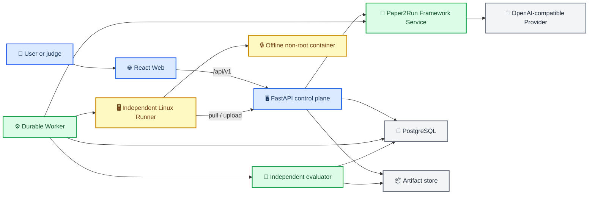
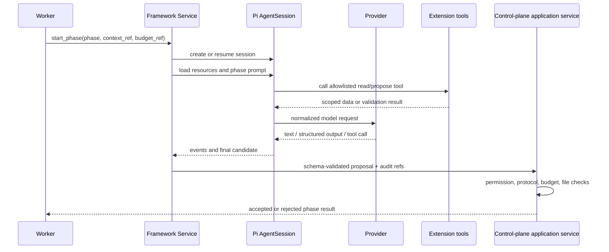
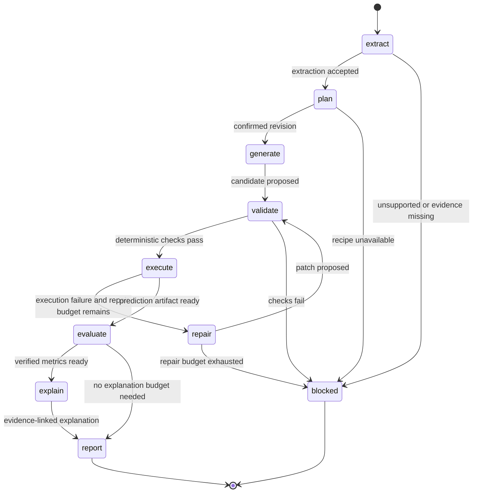
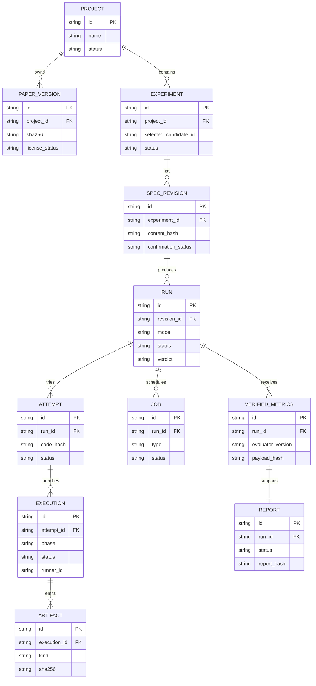
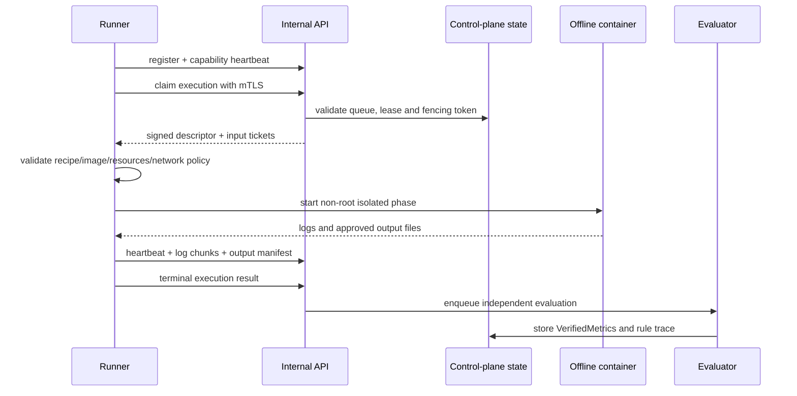

# Paper2Run 统一工程设计

_首版黑客松 Demo 的唯一工程总设计；面向产品、后端、Worker、Runner、前端和评测协作。本文是待实现的设计基线，不代表工程、模型、GPU、部署或赛事规则已经验证。_

---

> **阅读优先级：** 本文统一定义首版的系统边界、职责、数据流、接口分层、状态机和验收原则。旧文档仍保留为专题细节，但与本文冲突时以本文和后续用户确认的决策为准；公共浏览器接口以 [前后端公共接口契约 v0.2](09-前后端公共接口契约.md) 为联调细节来源。
>
> **当前实现状态：** 仓库目前只有产品资料、静态原型和设计文档，尚无可运行的 Web、API、Worker、Runner、数据库迁移、Provider 实现、锁文件或真实训练记录。本文中的路径、命令、端口、环境变量和 API 均是实现契约，不能直接宣称已经存在。

## 🎯 目标与首版边界

### 产品定位

Paper2Run 是一个**证据驱动的论文实验复现工作台**。它把论文 PDF 中有来源的实验描述，转化为用户可确认的实验协议，再生成受控执行候选，经过隔离运行、有限修复和独立评测，最后输出可追溯的证据报告。

首版解决的问题不是“任意论文自动证明是否正确”，也不是“让模型写一段 Python”。首版必须让用户能回答以下问题：

- 这次运行具体依据了论文哪一页、哪张表或哪一段？
- 用户确认的实验协议和原文之间有哪些差异？
- 生成的代码、修复补丁和每次执行分别是什么？
- 训练和预测是否真的完成，预测文件是否完整且可评测？
- 最终数字来自哪个独立评测器，而不是来自日志或模型回复？
- 这次结果是 `matched`、`outside_tolerance`、`not_comparable`，还是只证明流程失败/成功？

### 首版成功标准

首版以**邀请制、单团队、多项目、单 GPU 执行槽**为默认部署目标，优先支持明确包含 CIFAR-10 图像分类实验的论文。成功标准必须以实际证据验收，不能用 UI 截图或占位数字替代。

| 目标 | 必须具备的证据 | 不得用什么替代 |
|---|---|---|
| 论文可解析 | PDF SHA-256、页码/区域定位、结构化 Extraction 和缺失字段 | 模型回复中的无来源摘要 |
| 协议可确认 | 不可变 `ExperimentSpec` revision、用户确认记录、差异说明 | 前端本地状态 |
| 代码可执行 | 受支持 recipe 的文件清单、校验结果、Runner execution 记录 | stdout 中的“success” |
| 流程可运行 | 至少一次 CIFAR-10 小规模真实训练、预测和独立评测记录 | 静态原型或 replay |
| 结果可信 | 固定独立评测器输出 `VerifiedMetrics`、预测 hash、标签 manifest hash | 生成代码写出的 `metrics.json` |
| 结论诚实 | `verdict` 与实验模式、协议差异和证据完整性一致 | `run.status=completed` |
| 可复盘 | 论文、协议、代码、补丁、日志、预测、评测、报告和审计关联 | 单个下载压缩包无索引 |
| 可演示 | `mock-ui`、`local-cpu`、`remote-gpu`、`replay` 状态清楚区分 | 用历史数据冒充新运行 |

### 首版支持与明确不支持

| 范围 | 首版决策 |
|---|---|
| 用户 | 邀请成员；单团队、多项目；评委可通过只读演示入口查看已授权历史 |
| 论文 | 优先包含 CIFAR-10 图像分类实验的论文；不支持的论文可解析与导出，但不能悄悄套用示例实验 |
| 数据集 | 只使用维护者审核过的数据集、split、标签 manifest 和许可记录 |
| recipe | 只执行维护者审核过的 recipe；recipe 版本和镜像 digest 必须锁定 |
| 模型 | 服务端配置的 OpenAI-compatible endpoint；Qwen/百炼通过兼容接口接入；首版不维护独立 Qwen 专用适配器 |
| 执行 | 独立 Linux Runner；非 root、受控容器、默认断网、资源限制；单 GPU 执行槽 |
| 评测 | 训练、预测和可信评测分离；最终数字来自固定独立评测器 |
| Web | React + TypeScript + Vite；浏览器只访问 `/api/v1` |
| 控制面 | FastAPI + Pydantic 2；PostgreSQL + SQLAlchemy 2 + Alembic；独立 Python Worker |
| 首版不做 | 任意 GitHub 仓库执行、任意依赖安装、自动联网找数据、公开匿名执行、计费、多租户集群、社区排名、完整 Transformer/DQN/U-Net/NLP/RL 复现、任意容器逃逸防护承诺 |

### 两组必须分开的模式

实验协议模式描述“这次实验想怎样做”；运行展示模式描述“这次系统从哪里取得能力和数据”。二者不能合并成一个字段。

| 实验模式 | 作用 | 允许的结论 |
|---|---|---|
| `smoke` | 少量数据/步骤，检查候选能否训练、预测和回收产物 | 流程跑通或失败；通常 `not_comparable` |
| `scaled` | 缩减数据、步骤或模型规模，验证简化设置 | 简化设置下的结果；通常 `not_comparable` |
| `reference` | 尽量遵循已确认的原文实验协议 | 在证据足够且差异允许时比较选定指标 |

| 运行模式 | 作用 | 禁止误解 |
|---|---|---|
| `mock-ui` | 使用前端 fixture 演示页面状态 | 不代表模型、训练、GPU 或评测真实成功 |
| `local-cpu` | 本机受控 CPU Runner 做开发和 smoke | 不能宣称 Linux GPU 结果 |
| `remote-gpu` | 专用 Linux NVIDIA Runner 做真实验收 | 只有预检通过后才开放相应实验模式 |
| `replay` | 只读展示已授权历史记录 | 必须显著标记“历史回放”，不创建新运行 |

> **核心规则：** `run.status=completed` 只表示调度链路有终态，不表示论文结果匹配。只有独立评测完成、协议可比性成立、证据完整且固定规则通过时，才能产生 `matched`。

## 🏗️ 总体架构与职责边界

### 系统拓扑

下面的模块是可部署单元与逻辑模块的组合，不要求每个目录都拆成独立微服务。



### 组件职责

| 组件 | 负责 | 明确不负责 |
|---|---|---|
| React Web | 输入、展示、上传、协议编辑、状态同步、报告查看和下载 | 调模型、访问数据库/OSS/Docker、决定指标或 verdict |
| FastAPI 控制面 | 身份、权限、论文、Extraction、revision、预算、run、任务、租约、artifact、报告和公共 API | 在 API 进程中执行生成代码或直接操作 Docker |
| Framework Service | 封装 Pi SDK、Agent loop、Provider、Extension、session、上下文和模型调用审计 | 覆写最终状态、评测数字、标签、容差、资源权限或确认协议 |
| Worker | 领取持久任务，驱动阶段，续租，调度 Runner，结算预算，恢复和对账 | 持有 GPU 期间的数据库长锁；绕过 Runner 执行候选代码 |
| Runner | 校验 execution descriptor，启动受控容器，训练/预测，回收日志和产物，取消/超时清理 | 访问模型 Key、数据库凭据、Docker socket 或任意用户命令 |
| 独立评测器 | 读取受保护标签和预测文件，验证覆盖，计算固定指标，写入 `VerifiedMetrics` | 加载生成训练代码、读取 stdout 作为指标、接受生成的参考值 |
| PostgreSQL | 业务事实、状态机、持久 job、租约、预算账本、审计索引 | 存放浏览器可读密钥或替代 artifact 原文 |
| ArtifactStore | 论文、代码、日志、预测、报告和导出包的内容存储 | 直接向浏览器开放未授权对象路径 |

### 控制面与智能面的边界

Paper2Run Framework Service 是产品的智能编排层，但它不是事实裁决器。所有模型输出都必须进入确定性边界：

1. 先由 Provider 返回模型结果，并记录脱敏的调用审计。
2. 再由本地 schema 校验、协议校验、权限策略和文件白名单校验。
3. 通过后才写入候选 Extraction、规划草稿、代码候选或解释草稿。
4. 最终业务状态、预算、容器权限、独立评测和 verdict 只能由确定性控制程序写入。

任何模型输出都可能包含错误、提示注入、恶意 HTML、命令片段、伪造数字、路径穿越或要求泄露 Secret 的内容。系统按不可信输入处理。

## 🗂️ 工程目录与文件责任

首版采用模块化单体控制面和独立进程。目录名表达责任边界，不意味着每个目录都单独部署。

```text
apps/web/                         React + TypeScript + Vite 前端
services/api/                     FastAPI 公共 API 与内部入口
services/worker/                  持久任务 Worker、租约、恢复与调度
services/runner/                  独立 Linux Runner 主循环、reaper、容器执行
services/framework/               Paper2Run Framework Service 与 Pi SDK 装配
packages/contracts/               Pydantic/JSON Schema/OpenAPI/TS 生成契约
packages/persistence/             SQLAlchemy models、repository、UnitOfWork、迁移入口
packages/identity/                邀请、会话、项目成员与权限策略
packages/projects/                项目、论文、版本和上传元数据
packages/ingestion/               PDF ingestion、页图/文本抽取、hash 与限制
packages/paper_parser/            Extraction schema、来源定位、候选实验与审核
packages/experiment/              ExperimentSpec、Revision、确认、差异和 recipe 匹配
packages/orchestration/           jobs、stage、run、attempt、execution、预算、租约
packages/model_gateway/           Provider Port、能力探测、用量、脱敏、重试策略
packages/providers/                OpenAI-compatible 唯一首版真实适配器
packages/agent_tools/             Pi Extension、工具白名单、阶段策略和审计包装器
packages/codegen/                 代码候选、文件清单、patch、静态验证和密封
packages/execution/               execution descriptor、Runner client、取消与回收协议
packages/evaluation/              预测校验、固定 evaluator、VerifiedMetrics、verdict
packages/artifacts/               对象存储抽象、manifest、hash、下载票据与导出
packages/reporting/               确定性 report.json/Markdown/PDF 数据模型
recipes/cv_classification/        维护者审核的 CIFAR-10 等 recipe 与版本清单
sandbox/images/                   维护者审核的镜像引用和 digest 记录
prompts/                          按阶段、版本化、无 Secret 的提示模板
tests/                            unit、contract、integration、e2e、security、failure injection
fixtures/                         mock-ui、gold extraction、受控预测和 replay 索引
deploy/                           local-cpu、remote-gpu、反向代理、mTLS、备份配置
scripts/                          contract generation、doctor、fixture、导出和校验脚本
benchmarks/                       仅保存真实测量记录，不预写成功率或性能数字
```

### 文件责任规则

- `packages/contracts/` 是 HTTP DTO 的唯一源头；前端类型由契约生成或同步校验，组件不得维护第二套状态 DTO。
- `packages/persistence/` 只负责持久化映射和事务边界，不包含模型 Prompt 或 Runner shell。
- `services/framework/` 只负责 Agent 编排和模型交互；业务写入必须通过受控 application service。
- `services/worker/` 只能调用 application service 与内部 API client，不能从 job payload 拼接任意 shell。
- `services/runner/` 只接受签名且已审核的 descriptor；不能通过环境变量接收任意 argv。
- `recipes/`、`sandbox/images/`、标签 manifest 和 evaluator 版本均需代码评审；用户上传内容不得修改它们。
- `prompts/` 不得写入 Key、cookie、内部 URL 或未经脱敏的个人信息。

## 🧠 Paper2Run Framework Service

### 定位与调用关系

Framework Service 把 Pi 开源 Agent Harness 定制为 Paper2Run 的服务端框架层。首版采用 **Pi SDK + Extension**，不分叉 Pi CLI，不把 `pi --mode rpc` 作为首版核心集成路径。Pi 的具体 npm 包、源码版本、许可证、发布渠道和稳定 API 仍需首次实现前锁定，并记录在依赖清单和兼容性报告中。



### Framework Service 内部层次

| 层 | 责任 | 输出 |
|---|---|---|
| `session_factory` | 根据 project/experiment/run/phase 建立或恢复 Pi session | session handle、持久化策略、resource loader |
| `runtime` | 选择已批准的 model/provider，配置超时、流式和 tool policy | normalized model runtime |
| `resource_loader` | 将论文证据、协议、recipe、历史错误和规则装配为只读上下文 | 有来源的 prompt resources |
| `extension_registry` | 注册 Paper2Run 工具、命令和生命周期监听器 | phase-scoped tool set |
| `event_bridge` | 将 Pi 事件转为内部事件，脱敏后写入事件表和 SSE 可读流 | `framework.*` events |
| `proposal_validator` | 校验结构化输出、文件清单、patch、解释引用和预算 | typed proposal 或拒绝原因 |
| `audit_sink` | 记录 provider、model、prompt version、session、token、耗时和错误分类 | model call audit |
| `session_store` | 保存 session 索引、事件摘要和必要的 JSONL/session artifact | 可恢复 session metadata |

### Session 生命周期与持久化

一次 Agent phase 使用一个与业务对象绑定的 session context：

```text
project_id + experiment_id + revision_id + run_id + attempt_id + phase
```

首版保存以下内容：

- `framework_session`：Pi session id、phase、业务对象、创建/恢复时间、状态和最后事件序号。
- `framework_session_artifact`：必要的 session JSONL 或压缩 artifact、hash、schema/version、存储位置和保留策略。
- `framework_event`：阶段开始、工具调用、模型调用摘要、候选生成、拒绝、settle、错误和恢复事件。
- `model_call_audit`：provider、model id、endpoint alias、request/response hash、token usage（若 provider 返回）、费用映射（若可得）、重试次数和错误分类；不保存 Key。

默认不把完整模型原文无限写入业务表。若需要审计完整 prompt/response，则存入访问受控 artifact，并先进行 Secret/个人信息脱敏。日志和 session artifact 均视为不可信输入，报告引用前需转义。

Session 恢复必须遵守：

- 恢复不改变已经确认的 `ExperimentSpec` revision。
- 恢复不重置 run 总预算、修复次数、模型调用额度或阶段 deadline。
- 网络恢复导致的重复调用必须有 attempt/call id 和账本对账，不宣称外部 Provider exactly-once。
- 如果 session artifact 损坏，创建新的派生 session，但不覆盖旧 session；业务状态由控制面决定。
- `fork` 只用于明确的派生探索，并继承原 run 的预算与修复上限，不得绕过限制。

### Extension 与工具注册原则

Pi Extension 只暴露 Paper2Run 的最小工具集合。每个工具必须登记：

- `tool_name`、版本、阶段、输入/输出 schema；
- 可访问的 project/experiment/revision/run/attempt 范围；
- 是否只读、是否产生 proposal、是否消耗预算；
- 审计事件名和拒绝原因；
- 超时、大小和调用次数限制。

首版推荐工具集合：

| 工具 | 阶段 | 权限 | 说明 |
|---|---|---|---|
| `paper.read_evidence` | `extract`、`explain` | 只读 | 读取 PDF 页、文本片段、表格定位和 hash；不能任意读取宿主文件 |
| `experiment.read_candidate` | `extract`、`plan` | 只读 | 读取候选实验和缺失字段 |
| `recipe.inspect` | `plan`、`generate` | 只读 | 读取已审核 recipe、镜像 digest、数据集和 evaluator 版本 |
| `run.read_context` | `repair`、`explain` | 只读 | 读取受限的失败摘要、日志片段和产物检查结果 |
| `code.propose` | `generate` | 提案 | 返回文件清单和内容引用，不能直接写 Runner |
| `patch.propose` | `repair` | 提案 | 返回受限 patch；不能增加任意文件或修改禁区 |
| `explanation.propose` | `explain` | 提案 | 只能引用已有 `evidence_id`，不能写最终数字和 verdict |
| `session.note` | 全阶段 | 受控写入 | 写入可审计的阶段笔记，不改变业务事实 |

明确禁止注册：任意 shell、任意 Python 执行、任意网络请求、Docker 控制、数据库 SQL、密钥读取、标签读取、评测器修改、参考值修改和 artifact 路径拼接工具。

## 🔌 Provider 与模型配置

### 首版适配策略

首版只实现一个 `OpenAICompatibleProvider`，通过配置的 `base_url`、模型 ID、鉴权引用和兼容能力访问用户选择的 endpoint。Qwen/百炼只作为该适配器的服务端配置，不维护另一套 Qwen 专用 API 客户端。

```text
ProviderPort
  └── OpenAICompatibleProvider
        ├── OpenAI-compatible chat/responses transport
        ├── streaming adapter
        ├── structured-output adapter
        ├── tool-call adapter
        ├── image-input mapping（若能力探测通过）
        └── retry / usage / error normalization
```

真实接入前必须人工确认并记录：endpoint 地域、鉴权方式、模型 ID、文本/图像输入、流式输出、结构化输出、工具调用、上下文长度、额度、计费和数据处理条款。未知能力必须显示为 `unknown`，不能由模型名称推断。

### Provider Port

```python
class ProviderPort(Protocol):
    async def probe_capabilities(
        self, request: CapabilityProbeRequest
    ) -> CapabilityProbeResult: ...

    async def complete(
        self, request: NormalizedModelRequest
    ) -> AsyncIterator[NormalizedModelEvent]: ...

    async def estimate_usage(
        self, request: UsageEstimateRequest
    ) -> UsageEstimate: ...
```

`NormalizedModelRequest` 至少包含：

- `provider_config_id`、`model_id`、`phase`、`call_id`；
- system/developer/user messages 的角色和内容类型；
- 可选图像引用，引用由服务端转为受控 bytes 或短期授权 URL，绝不把私有 OSS 凭据交给模型；
- response schema 标识和版本；
- tool definitions，只包含本阶段 Extension；
- timeout、最大输出预算、streaming、temperature 等经允许的 runtime 参数；
- `context_hash`、`prompt_version` 和 `policy_version`。

`NormalizedModelEvent` 统一为 `delta_text`、`structured_delta`、`tool_call`、`usage`、`warning`、`completed`、`failed`。Provider 原始响应存储需脱敏，业务层只依赖规范化事件。

### 错误、重试与额度

| 错误类别 | 处理 | 是否自动重试 |
|---|---|---|
| `auth_invalid` | 立即结束该阶段，提示管理员检查 Secret/endpoint | 否 |
| `permission_denied` | 标记能力或模型不可用，不换未批准模型 | 否 |
| `rate_limited` | 在剩余 deadline 和预算内有限退避 | 有界 |
| `timeout` | 记录 call 失败；只有策略允许时重试 | 有界 |
| `network_transient` | 记录 transport failure，按 call id 对账 | 有界 |
| `invalid_response` | schema 校验失败，可请求一次受限修正；不把原文当事实 | 有界 |
| `content_policy` | 结束并保留脱敏诊断 | 否 |
| `server_error` | 按 provider policy 有界处理 | 有界 |
| `budget_exhausted` | 不再调用模型；生成确定性最小报告 | 否 |

预算至少分为：阶段调用预算、run 总模型调用预算、修复次数、GPU/Runner 时间预算和导出资源预算。预算预留与结算由控制面账本完成，Provider 不能自行增加预算。

### Secret 与模型配置

浏览器只看到 `provider_config_id`、显示名、能力状态和脱敏 endpoint alias，不接触 Key。Secret 只能存在于服务端 Secret Store、Worker 环境或受控 Provider Gateway。Runner 容器、生成代码、日志、SSE、artifact 和导出包中不得出现模型 Key。

Provider 配置更新不修改历史 `model_call_audit`。每次调用保存不可变的 `provider_config_revision` 和 `model_id` 快照；删除配置只阻止新调用，不抹除历史审计。

## 🧩 Agent 阶段与输出边界

### 阶段总览



### `extract`

输入是经过 ingestion 的 PDF 版本、页级证据和解析规则。输出是 `ExtractionCandidate`，而不是已经确认的实验协议。

必须抽取并保留来源：

- 论文身份、版本、PDF SHA-256；
- 实验任务、数据集、split、预处理和数据许可线索；
- 模型/算法结构和训练配置；
- 指标名称、方向、单位、统计方式和参考值；
- 原文页码、章节、表格、行/列、摘录和可选 bbox；
- 缺失、歧义、互相矛盾和需要人工确认的字段；
- 是否能匹配维护者审核的 recipe。

来源不清晰时写 `unknown` 或 `needs_review`，不补造数值。模型不能直接写入 `ExperimentSpec`。

### `plan`

输入是用户选择的候选实验和 `ExtractionCandidate`。输出是协议草稿、recipe 匹配结果、差异和资源估计。只有用户确认后才生成不可变 revision。

`plan` 不能：

- 自动将 ImageNet 换成 CIFAR-10；
- 将预训练权重评测伪装成从头训练；
- 改写测试集、标签、指标、容差或参考值；
- 在没有 recipe 的情况下声称可执行；
- 直接创建 run 或消耗 GPU。

### `generate`

只对已确认 revision、已选 recipe 和通过预算门禁的 run 生成代码候选。输出必须是结构化 `CodeCandidate`：文件相对路径、内容/hash、语言、入口、依赖声明、recipe version、prompt/model 审计引用。

生成代码必须满足：

- 文件路径是相对路径并落在 recipe 白名单；
- 不包含网络访问、动态安装、未知二进制、路径穿越或 Secret 读取；
- 不修改测试集、标签、评测器、参考值、容差、镜像、锁文件和资源限制；
- 训练、预测入口和输出 manifest 与 recipe 契约一致；
- 不向 stdout 伪造最终指标作为可信结果。

### `repair`

修复是有限的、可审计的补丁，不是无限 agent loop。每个 patch 绑定上一个 `Attempt`、失败证据、修复理由、允许修改的文件和消耗的修复预算。

允许修复：语法错误、受支持 API 使用错误、输出路径不符合 recipe 契约、形状/批处理错误、资源配置在允许范围内的调整。禁止修复：修改标签、测试集、评测器、参考值、容差、数据许可、镜像 digest、锁文件或资源上限。

### `explain`

只在报告数字和 verdict 由确定性程序冻结后运行。输出是引用 `evidence_id` 的叙述草稿：说明协议、差异、执行过程、证据充分性和限制。模型不能覆写 `report.json` 的数字、`verdict`、参考值、容差或比较资格。

## 📄 论文、实验协议与 Revision

### Ingestion 与论文事实

论文上传流程：

1. 校验文件类型、大小、页数和 PDF 结构；拒绝明显的路径穿越、伪造扩展名和超限归档。
2. 计算 SHA-256，创建不可变 `PaperVersion`。
3. 生成页级文本/图像 artifact 和来源索引；原文件不覆盖。
4. 建立解析任务，分配 Framework Service 的 `extract` phase。
5. 保存候选 Extraction、来源、缺失和 recipe 匹配诊断。

如果用户输入的是外部论文 ID，首版不能默认任意联网抓取。只有经产品配置允许的固定来源和明确的 ingestion policy 才能抓取；否则要求用户上传 PDF。

### `ExperimentSpec` 与 revision

`ExperimentSpec` 是用户希望执行的实验事实；`Revision` 是不可变的协议版本。典型字段包括：

| 字段组 | 内容 |
|---|---|
| 来源 | paper version hash、evidence ids、页/章节/表格/摘录 |
| 实验身份 | task、dataset、split、model、method、recipe id/version |
| 数据 | dataset manifest hash、标签 manifest hash、许可状态、预处理、随机种子策略 |
| 训练 | optimizer、learning rate、schedule、batch、steps/epochs、初始化和 checkpoint policy |
| 评测 | metric、方向、统计方式、预测 schema、参考值来源、容差来源 |
| 资源 | execution mode、CPU/GPU、显存/内存/时间上限、镜像 digest |
| 差异 | 与论文的结构化 diff、差异类别、是否允许比较 |
| 审批 | draft/confirmed/revoked、操作者、时间、确认时的 content hash |

协议确认后不可原地修改。用户想改任何语义字段时：

```text
draft changes
  → new Revision
  → new confirmation
  → optional derived Run
```

只读展示性字段可以不新建 revision，但必须由确定性规则定义。论文 PDF 新版本、数据 manifest 变化、recipe 版本变化、evaluator 版本变化或参考值来源变化，都必须重新评估并通常创建新 revision。

### 比较资格

`comparability` 是确定性计算的结构化结果，不是模型判断。至少区分：

- `comparable`：关键数据、任务、指标、统计口径和协议条件满足规则；
- `conditionally_comparable`：存在已披露且规则允许的差异；
- `not_comparable`：`smoke/scaled` 或关键条件变化；
- `insufficient_evidence`：关键来源或预测证据不足。

`reference` 也可能因为执行失败、证据不完整、协议偏离或评测不合格而不能比较。

## 🔄 Run、Attempt、Execution 与 Worker

### 业务对象关系



### 对象语义

- `Experiment`：论文中一个实验意图和预算容器；等待确认时不占用 GPU。
- `Revision`：不可变实验协议；确认状态属于 revision。
- `Run`：基于已确认 revision 的一次用户运行；拥有总预算和最终 verdict。
- `Attempt`：一次候选代码/patch 版本；修复新代码时创建新 attempt。
- `Execution`：某个 attempt 的一次具体 Runner 进程执行；网络恢复重发 descriptor 不得无依据增加 attempt。
- `Job`：可恢复、可租约、可重试的持久任务；不等同于 HTTP 请求。
- `Artifact`：内容不变的文件元数据和访问控制；内容通过 hash 绑定。
- `VerifiedMetrics`：独立评测器生成的可信指标事实；不是模型或 stdout 写出的指标。
- `Report`：由确定性报告器从事实表和 artifact manifest 生成的独立产物状态。

### Worker 任务类型

首版 Worker 至少支持：

```text
paper_ingest
extract
plan
code_generate
code_validate
run_dispatch
runner_reconcile
repair
evaluate
report_build
export_build
session_compact
artifact_gc
```

每个 job 具有 `id`、`type`、`payload_ref`、`status`、`available_at`、`attempt_count`、`lease_owner`、`lease_expires_at`、`fencing_token`、`last_error_class`、`created_at` 和 `updated_at`。payload 只保存不可信引用与受控参数，不把完整用户文件塞入任务表。

### 领取、租约与 fencing

Worker 领取任务使用 PostgreSQL 持久队列和 `FOR UPDATE SKIP LOCKED`。处理步骤：

1. 短事务选择可领取 job，写入 lease owner、过期时间和 fencing token。
2. 事务提交后执行模型调用、Runner 调度或 artifact 处理；不持有 GPU 时段长锁。
3. Worker 周期性心跳更新租约，更新必须携带当前 fencing token。
4. 租约过期后，其他 Worker 可接管；旧 Worker 的结果写入会因 token 不匹配被拒绝。
5. 结算阶段重新读取事实状态，幂等写入阶段结果和账本。

Runner execution 也有独立 lease。控制面不能因为 Worker 进程退出就假定容器停止，必须由 Runner reaper、心跳和 reconcile 处理。

### 状态与终态规则

Job 的状态建议为：`queued → leased → running → succeeded|failed|cancelled|expired`。Run 的状态至少区分：`created`、`waiting_confirmation`、`queued`、`generating`、`executing`、`evaluating`、`completed`、`failed`、`cancel_requested`、`cancelled`、`blocked`。

状态转换由后端状态机集中验证；客户端不能通过 PATCH 任意写状态。终态不能直接重开，需创建新的派生 run 或新的 export operation。

## 🔒 Runner 隔离与执行协议

### Runner 信任边界

Runner 是独立 Linux 主机上的受控执行面。控制面和 Worker 不挂 Docker socket，不在 API/Worker 主机执行生成代码。Runner 不持有数据库凭据、Provider Key 或任意 Docker 管理权限。

执行前必须校验：

- Runner 身份、mTLS 证书和能力注册；
- 由控制面签名或完整性保护的 execution descriptor；
- recipe id/version、镜像 digest、dataset manifest hash、evaluator version；
- phase 是否为允许阶段；
- CPU/GPU/内存/磁盘/时间限制是否来自服务端策略；
- 输入 artifact 的 hash、大小、类型和许可状态；
- 输出路径是否落在受控 workspace；
- 当前 Runner 是否已有活动 execution；单 GPU 槽不得并行超额。

### Descriptor

Runner 只接受结构化 descriptor，不接受任意 shell 或 argv。descriptor 至少包含：

```json
{
  "execution_id": "opaque",
  "attempt_id": "opaque",
  "run_id": "opaque",
  "phase": "train|predict|evaluate_prepare",
  "recipe": {"id": "approved", "version": "locked"},
  "image": {"ref": "approved", "digest": "sha256:..."},
  "inputs": [{"artifact_id": "opaque", "sha256": "...", "mount": "read_only"}],
  "outputs": [{"kind": "prediction|checkpoint|log|manifest", "path": "relative/path"}],
  "resources": {"gpu": "policy_ref", "cpu": "policy_ref", "memory": "policy_ref"},
  "network": "disabled",
  "signature": "server_signature"
}
```

示例只描述字段形状；真实签名算法、descriptor schema version、镜像和资源 policy 必须在实现前锁定并测试。`signature` 不代表当前已部署签名系统。

### 容器策略

- 非 root 用户和最小权限；
- root filesystem 尽量只读，workspace 使用受控临时目录；
- 默认无网络、无宿主机敏感目录挂载、无 Docker socket；
- 只挂载必要输入，标签 manifest 只读且与训练/预测上下文分离；
- 限制 CPU、内存、磁盘、GPU、进程数、文件大小和 wall-clock；
- watchdog 处理 stdout/stderr、僵死进程、超时和取消；
- reaper 在主循环崩溃后仍能清理遗留容器；
- 回收前生成文件 manifest、hash、大小和退出原因；
- 容器隔离测试失败时，禁止开放用户上传执行。

容器不是完全防逃逸证明。首版的安全声明必须限定为“在已验证的宿主、镜像、运行参数和访问策略下的受控执行”，不能承诺对未知内核漏洞或恶意宿主管理员的防护。

### 训练、预测和评测分离

训练阶段只产生受控 checkpoint、训练日志和训练 manifest。预测阶段在独立输入/权限下产生 prediction artifact。可信评测阶段不加载生成训练代码，不读取生成的指标文件，不使用训练日志中的数字，只读取：

- 通过 schema 校验的预测文件；
- 受保护的标签 manifest；
- 受保护的 sample ID/split manifest；
- 固定 evaluator 版本和 metric policy。

## 🧪 独立评测、Verdict 与证据报告

### 预测检查

评测器在计算指标前必须拒绝以下情况：

- sample ID 缺失、重复或超出 split；
- 预测覆盖不完整；
- 预测类别维度与 recipe 不符；
- NaN、Inf、非法概率或非法 label；
- 文件 hash、manifest hash 或来源不匹配；
- 评测所需的标签/数据许可状态无效；
- 指标方向、单位、聚合方式不在固定 policy 中。

### `VerifiedMetrics`

`VerifiedMetrics` 至少绑定：

- `run_id`、`execution_id`、prediction artifact id/hash；
- label manifest id/hash、split id/hash；
- evaluator version、metric policy version；
- metric payload hash、计算时间和输入 schema version；
- 逐指标值、单位、方向、统计方式和有效样本数；
- 检查项结果和拒绝原因（若失败）。

评测器不能接受用户或模型提供的参考值作为实际指标。参考值只能来自有来源的论文证据，并保留原始单位、转换表达式、页码/表格/行和人工确认记录。

### Verdict 规则

| Verdict | 条件 |
|---|---|
| `matched` | execution 完成，预测和评测证据完整，协议比较资格成立，指标在已确认容差内 |
| `outside_tolerance` | execution 和评测证据完整，可比较，但指标未落入容差 |
| `not_comparable` | smoke/scaled 或存在规则不允许的关键协议差异 |
| `execution_failed` | 训练/预测/产物回收未完成，无法形成有效评测 |
| `insufficient_evidence` | 关键论文来源、预测覆盖、标签/manifest、evaluator 或审计证据缺失 |

`verdict` 由确定性程序产生。模型解释只能引用已经存在的 evidence id。报告渲染失败不改变已有 run/verdict；可以重试 `report_build` 或 `export_build`。

### 报告结构

`report.json` 的事实层至少包含：

```text
report_schema_version
run / revision / attempt / execution identity
experiment mode and runtime mode
paper source and evidence references
protocol snapshot and structured diff
recipe/image/dataset/evaluator identifiers and hashes
execution timeline and termination reason
verified metrics and comparability
verdict and deterministic rule trace
artifact manifest and download policy
model explanation references (optional)
limitations and missing evidence
```

报告必须有最小确定性 fallback：即使模型额度耗尽、解释阶段失败或 PDF 渲染失败，也能生成 JSON/Markdown 诊断。不能为了等模型解释而丢失训练历史或评测事实。

## 🌐 公共 API `/api/v1`

### 分层原则

公共 API 是浏览器和受邀客户端的产品契约。它不暴露 Pi session 原语、Provider 原始响应、Runner descriptor、内部任务 lease、数据库连接或 Secret。

公共 API 由 FastAPI 路由调用 application service，再由 application service 写入事实和 job。前端只使用统一 API Client；不在组件内补默认配置，不直接拼接内部 URL。

### 资源与主要端点

| 资源 | 方法 | 作用 | 同步/异步 |
|---|---|---|---|
| `/auth/session` | `GET` | 当前邀请身份和能力 | 同步 |
| `/projects` | `GET/POST` | 项目列表与创建 | 同步 |
| `/projects/{id}` | `GET/PATCH` | 项目概览与可编辑元数据 | 同步 |
| `/projects/{id}/papers` | `POST` | 上传 PDF 或受控来源入口 | `202` |
| `/papers/{id}` | `GET` | 论文版本、hash、ingestion 状态 | 同步 |
| `/papers/{id}/extractions` | `GET` | Extraction 候选、证据和缺失 | 同步 |
| `/experiments` | `POST` | 从候选实验创建 Experiment | 同步 |
| `/experiments/{id}/draft` | `GET` | 读取确定性草稿，不调用模型 | 同步 |
| `/experiments/{id}/revisions` | `POST` | 创建新 revision | 同步 |
| `/revisions/{id}/confirm` | `POST` | 确认不可变实验协议 | 同步 |
| `/runs` | `POST` | 基于 confirmed revision 创建 run | `202` |
| `/runs/{id}` | `GET` | run 状态、预算、阶段和 verdict | 同步 |
| `/runs/{id}/cancel` | `POST` | 请求取消 | `202` |
| `/runs/{id}/events` | `GET` | SSE 实时事件 | 流式 |
| `/runs/{id}/artifacts` | `GET` | artifact 元数据与受控下载票据 | 同步 |
| `/runs/{id}/report` | `GET` | 报告状态与事实层 | 同步 |
| `/runs/{id}/exports` | `POST` | 创建 JSON/Markdown/PDF/ZIP 导出 | `202` |
| `/operations/{id}` | `GET` | 异步操作状态 | 同步 |
| `/capabilities` | `GET` | 当前模式、recipe、provider 能力摘要 | 同步 |

精确 DTO、字段、分页、错误 envelope、状态载荷和前端 mock 以 [公共接口契约 v0.2](09-前后端公共接口契约.md) 为准。本文只定义边界和依赖关系，避免产生第二套公共字段标准。

### 通用约束

- JSON UTF-8；时间使用 UTC ISO 8601；ID 是不透明字符串。
- 写入 schema 默认拒绝未知字段；服务端负责 ID、hash、权限、状态、数字和 verdict。
- 列表使用稳定排序和 opaque cursor；不把数据库 offset 暴露为业务游标。
- 异步写接口返回 `operation_id`；HTTP 不长时间等待 GPU 或模型调用。
- 请求带 `X-Request-ID` 或由服务端生成 request id；客户端不能伪造服务器审计身份。
- 错误 envelope 统一包含可展示的 code、message、request_id 和可选 field errors；不返回 Secret、内部堆栈、宿主路径或 Provider 原始凭据。
- artifact 下载必须经过父项目、成员权限、许可状态、完成状态和短期票据校验。

### 写操作幂等

需要创建异步任务的写接口支持 `Idempotency-Key`。服务端以调用者、路由、key、请求 hash 绑定首次结果：相同 key 和相同请求返回原 operation；相同 key 但请求不同返回冲突。取消、确认、导出等操作还需校验当前状态，不能靠重复请求推进状态。

## 🔐 内部 API `/internal/v1`

### 内部 API 的适用对象

`/internal/v1` 只供 Worker、Runner、reaper、内部 evaluator 入口和控制面之间使用。它不能挂到公网反向代理，不能被浏览器调用，也不能作为 Framework Service 的公共 API。

内部 API 至少覆盖：

- Runner 注册、能力心跳和健康检查；
- execution 领取、descriptor 拉取、心跳、日志分片、产物 manifest；
- cancel/timeout/reconcile；
- Worker 阶段提交、事件写入和账本结算；
- evaluator 提交 `VerifiedMetrics`；
- artifact 受控上传/下载票据；
- fencing token 和 lease 校验。

### Runner 交互顺序



内部接口必须采用 schema version、request id、execution id、fencing token 和幂等键。Runner 不接受客户端传入的任意 container command；所有允许的入口来自已审核 recipe。

## 📡 SSE 与事件同步

### 事件来源

SSE 只是传输层，不是事实存储。事件先写入数据库的 append-only `event` 表，再由 API 按 `Last-Event-ID` 或 opaque cursor 推送。页面断线后先拉取当前资源状态，再从最后事件位置补事件，不能只依赖内存广播。

事件至少包含：

```text
id
occurred_at
aggregate_type / aggregate_id
sequence
kind
payload_schema_version
safe_payload
request_id / operation_id
```

`safe_payload` 不能包含 Key、完整 prompt、私有路径、原始标签或未经转义的模型 HTML。模型流式 delta 可以只保存摘要或受控 artifact 引用。

### 事件与状态的一致性

- 数据库状态是事实；SSE 丢失不改变事实。
- 事件 sequence 对每个 aggregate 单调递增；重复事件由客户端去重。
- Worker/Runner 心跳事件只用于展示，不替代 lease 事实。
- `replay` 模式读取历史事件和报告，不生成假实时事件。
- SSE 连接超时和重连不能创建新 operation 或 run。

## 🗃️ 数据模型、审计与不可变性

### 核心表/实体

| 实体 | 关键内容 | 变更规则 |
|---|---|---|
| `user` / `membership` / `invite` | 邀请身份、团队、项目权限 | 权限变化可审计 |
| `project` | 名称、状态、创建人和访问策略 | 软归档，不跨项目读取 |
| `paper_version` | 原文件 hash、来源、许可、页数、ingestion 状态 | 内容不可覆盖 |
| `evidence` | 页、章节、表格、行、摘录、bbox、来源 hash | 追加/修订，不覆盖原定位 |
| `extraction` | 候选实验、字段值、置信/缺失/冲突 | 候选可重跑，旧结果保留 |
| `experiment` | 选定候选、总预算、当前 head | 业务意图容器 |
| `spec_revision` | 完整协议 snapshot、content hash、diff | 不可变 |
| `confirmation` | 操作者、时间、revision hash、确认声明 | 不可变 |
| `recipe` / `image_policy` | 审核版本、镜像 digest、许可和能力 | 代码评审后发布 |
| `run` | 模式、预算、状态、verdict、来源 revision | 终态事实可审计 |
| `attempt` / `execution` | 代码 hash、patch、Runner execution 和退出原因 | append-only 轨迹 |
| `job` / `lease` | 持久队列、租约、fencing、重试 | 状态机控制 |
| `artifact` / `artifact_manifest` | kind、hash、大小、来源、权限和保留 | 内容不可变 |
| `model_call_audit` | provider、模型、prompt version、usage、错误 | 不保存 Key |
| `verified_metrics` | 评测输入 hash、evaluator、payload 和指标 | 只能由 evaluator 写入 |
| `report` / `export` | 报告状态、hash、格式和下载票据 | 产物状态独立 |
| `audit_log` | 敏感操作、权限拒绝、状态变更 | append-only |

### Hash 绑定

必须区分“内容一致”和“来源可信”。hash 绑定包括：

```text
paper_sha256
protocol_content_hash
code_candidate_hash
patch_chain_hash
image_digest
recipe_version
input_manifest_hash
prediction_sha256
label_manifest_hash
evaluator_version
metric_payload_hash
report_hash
```

hash 一致只能证明当前 bytes 一致，不能替代数据许可、论文来源、镜像信任或实验语义审查。

### 预算账本

预算采用 append-only reservation/settlement/refund/charge 记录，不直接在多个进程中覆盖一个余额字段。每条账本绑定 owner、run、phase、call/execution id、预算类型、预留、实际、状态和 idempotency key。

派生 run 继承原 experiment 的总预算、已消耗额度和修复次数；不能通过创建新 run 重置预算。管理员明确批准的预算变更必须产生审计记录和新的 policy snapshot。

## 🛡️ 安全与不可信输入处理

### 输入分类

以下内容一律视为不可信：

- 论文 PDF、页文本、图像、表格和 OCR 结果；
- 用户填写的实验参数、项目名、文件名和导出名；
- 模型文本、结构化输出、tool call 参数和 session JSONL；
- 生成代码、patch、stdout/stderr、日志和 `metrics.json`；
- Runner 回传的文件名、manifest、退出消息和外部 URL；
- replay 导入包和历史事件 payload。

### 处理原则

- 所有结构化输入用严格 schema 校验，未知字段默认拒绝。
- 所有路径进行相对路径、规范化、软链接和大小校验；不把业务 ID直接拼宿主路径。
- 所有 HTML/Markdown/日志展示默认转义，下载文件不自动执行。
- PDF 解析、图像解码、压缩包读取和导出均有资源上限。
- 所有网络访问采用显式 allowlist；默认不联网。论文来源、Provider、artifact 传输和 Runner 控制分别配置。
- 不自动执行论文中的命令、安装依赖、下载权重或读取密钥。
- 前端禁止直连模型、OSS 管理接口、数据库、Docker、Runner 和 `/internal/v1`。
- 生成代码和容器不可读 host secret；模型 Key 不进入浏览器、artifact、日志、prompt 或 Runner。
- 所有安全拒绝都生成可解释的内部 code 和用户可读的安全提示，但不泄露内部防护细节。

## 🧪 测试、Mock、Live 与 Replay

### 测试分层

| 层级 | 覆盖 | 允许替身 |
|---|---|---|
| Unit | schema、状态机、预算、hash、比较资格、评测规则 | Provider、Runner、Clock |
| Contract | OpenAPI/JSON Schema、SSE、内部 descriptor、TS 类型 | fixture 服务 |
| Integration | PostgreSQL、Worker queue、artifact、lease、fencing、独立 evaluator | 本地受控容器 |
| Security | 路径穿越、恶意 PDF/ZIP、提示注入、Secret 泄露、跨项目访问、未知字段 | 安全 fixture |
| Failure injection | Worker 崩溃、租约过期、Runner 断开、Provider timeout、重复回调、取消竞态 | fault injector |
| E2E mock-ui | 页面状态、错误态、空态、取消、报告与下载交互 | 全部后端 fixture |
| E2E live | 真实 OpenAI-compatible 调用和真实 Runner | 只能在批准环境执行 |
| Evidence acceptance | 真实 CIFAR-10 smoke/scaled/reference 中至少一次训练、预测、评测和报告 | 不可用原型数字替代 |

### 四种模式的显式标识

页面、API、日志和报告必须同时显示：

```text
execution_backend: mock | local | remote
 data_mode: mock | live | replay
experiment_mode: smoke | scaled | reference
```

`replay` 只能读取已授权历史数据；没有真实历史记录时显示空态。不得把 fixture 叫作 replay，也不得把 replay 中的历史进度伪装成当前任务。

### 真实验收门禁

开放远程执行前必须逐项完成并留存证据：

- Linux NVIDIA GPU、驱动、CUDA/容器运行时和 GPU 资源策略通过兼容性检查；
- recipe、数据集、split、标签 manifest、镜像 digest 和 evaluator 版本锁定；
- Runner 隔离、断网、非 root、watchdog、reaper 和取消经过演练；
- OpenAI-compatible endpoint、模型 ID、能力、额度和费用由人工确认；
- 至少一次真实 CIFAR-10 小规模训练、预测和独立评测完成；
- 失败路径也能生成确定性报告；
- 日志、artifact、报告和录屏中无 Key、个人信息和未经许可的论文/数据内容。

## 🖥️ 本地启动、部署与演示

### 规划地址

| 单元 | 本地约定 | 边界 |
|---|---|---|
| Web | `127.0.0.1:5173` | 仅开发服务器；生产使用构建产物 |
| API 公共入口 | `127.0.0.1:8000` | 只提供 `/api/v1` |
| 内部入口 | `127.0.0.1:8443` 或私网地址 | 只提供 `/internal/v1`，需 mTLS |
| PostgreSQL | `5432` | 仅控制面私网访问 |
| Worker | 无业务公网端口 | 通过 DB 和内部 client 工作 |
| Runner | 私网主动连接 | 不暴露公网，不接受任意命令 |

### 规划命令

以下命令在实现前只是约定，当前仓库没有对应 Makefile 或服务工程：

```bash
make bootstrap MODE=local-cpu
make infra-up MODE=local-cpu
make migrate MODE=local-cpu
make dev MODE=local-cpu
make worker MODE=local-cpu
make runner MODE=local-cpu
make doctor MODE=local-cpu CHECK=preflight
make doctor MODE=local-cpu CHECK=ready
make test-unit TASK=T01
make test-integration TASK=T03 MODE=local-cpu
make test-e2e TASK=T08 MODE=mock-ui
make contracts-check
```

命令必须 fail closed：缺数据库、缺迁移、缺镜像、隔离未验证、GPU 不兼容、Provider 未配置或权限不足时，输出阻塞原因，不自动安装依赖、不自动调用收费模型、不自动开放执行。

### 两人协作边界

| 角色 | 负责 | 交接物 |
|---|---|---|
| 后端/执行负责人 | FastAPI、contracts、DB、Framework Service、Provider、Worker、Runner、评测、报告、安全和部署 | OpenAPI、状态载荷、SSE、fixture、真实验收证据 |
| 前端负责人 | React/Vite、路由、四视图、组件、API client、Mock、状态展示、报告交互和前端测试 | 按公共契约消费数据，不实现模型/DB/Docker/指标 |
| 共同维护 | 根锁文件、`packages/contracts/`、公共 API 变更、演示脚本和验收记录 | 串行合并，变更带 schema/version 和 request_id 证据 |

## ✅ 实施顺序与 Definition of Done

本文不是具体排期，但实现必须按依赖顺序推进，避免先堆 UI 再补可信执行：

1. 锁定 Pi 源码/发布包、版本、许可证和 SDK 兼容性；锁定 Python/Node/依赖和 provider contract。
2. 建立 contracts、PostgreSQL 基础迁移、身份/项目/论文/`ExperimentSpec` revision。
3. 完成固定 evaluator、预测 schema、artifact manifest 和 `VerifiedMetrics`，先用维护者 fixture 串起可信评测。
4. 完成 Worker queue、lease、fencing、预算和恢复；用故障注入验证至少一次语义。
5. 完成 Runner descriptor、非 root 断网容器、watchdog、reaper、取消和 manifest 回收。
6. 完成 Framework Service 的 Pi SDK + Extension 装配、session store、Provider Port 和 OpenAI-compatible adapter。
7. 完成 `extract → plan → confirm → generate → validate → execute → evaluate → report` 最小链路。
8. 前端先接 `mock-ui` 全状态，再接 `local-cpu`，最后接经批准的 `remote-gpu`；与 replay 严格分开。
9. 完成真实 CIFAR-10 小规模训练、预测、评测、报告和导出，记录所有实际环境与用量。
10. 完成安全审查、演示录屏、备份/恢复演练和提交材料核对。

某项 Definition of Done 只有在以下条件同时满足时才成立：

- 代码、schema、测试和迁移存在并通过对应静态检查；
- 失败、取消、恢复、重复回调和权限拒绝有测试；
- 真实依赖与 fixture 的边界在报告中明确；
- 没有使用原型中的占位成绩、曲线、价格、成功率或模型名作为实际事实；
- 相关证据文件、hash、版本和环境已保存；
- 尚未验证的内容写成阻塞或待确认，不写成“已支持”。

## 🚫 首版不做与变更规则

### 明确不做

- 不做任意论文自动复现承诺。
- 不做任意仓库 clone、任意依赖安装或任意 shell 执行。
- 不做公开匿名算力服务、计费、社区排名和多租户集群。
- 不做端侧小模型；Framework Service 只在服务端调用已配置 Provider。
- 不做独立 Qwen 专用适配器；Qwen/百炼走 OpenAI-compatible。
- 不做前端直连模型、数据库、OSS 管理面、Docker 或内部 API。
- 不做把模型解释、日志或生成的 `metrics.json` 当作最终指标。
- 不做未经人工核实的赛事截止时间、评分权重、数据许可、GPU 能力、预算或成功率承诺。

### 设计变更规则

任何涉及以下内容的改变，必须先更新本文和相关专题文档，再进入实现：

- Framework Service 与控制面的职责边界；
- Provider contract、Secret 流向或模型调用范围；
- `ExperimentSpec`/Revision/Run/Attempt/Execution 语义；
- Runner 隔离、网络、镜像或资源策略；
- evaluator 输入、指标、容差或 verdict 规则；
- 公共 API 前缀、DTO、SSE 事件或内部 API 信任边界；
- 首版支持论文、recipe、数据集或实验模式范围。

小范围实现选择可以通过代码评审决定，但不得用实现便利性悄悄削弱证据链、安全边界或实验可比性。

## 📚 相关文档与外部依据

### 仓库内专题文档

- [README 入口](../README.md)
- [技术架构](02-技术架构.md)
- [模块化与数据设计](05-模块化与数据设计.md)
- [接口定义](06-接口定义.md)
- [运行与部署](07-运行与部署.md)
- [前后端公共接口契约](09-前后端公共接口契约.md)
- [前端 GUI 交接说明](10-前端GUI交接说明.md)
- [开发任务包](08-开发任务包.md)
- [实施计划与验收](03-实施计划与验收.md)
- [比赛规则与交付清单](01-比赛规则与交付清单.md)

### 外部参考

[^1]: Pi 开源 Agent Harness 仓库，具体版本、包名和许可证须在实现前锁定。https://github.com/badlogic/pi-mono

[^2]: FastAPI 官方文档。本文只采用其作为拟定 Web 框架，具体版本需在依赖锁定时验证。https://fastapi.tiangolo.com/

[^3]: Pydantic 官方文档。本文使用 Pydantic 2 作为拟定 schema 实现，版本兼容性需由锁文件和 CI 验证。https://docs.pydantic.dev/

[^4]: PostgreSQL 行级锁与 `SKIP LOCKED` 文档。队列实现仍需结合事务、租约和故障注入测试。https://www.postgresql.org/docs/current/sql-select.html

[^5]: Server-Sent Events 的浏览器接口说明。SSE 在本文中只是状态事件传输层，数据库事件表仍是事实来源。https://developer.mozilla.org/en-US/docs/Web/API/Server-sent_events
